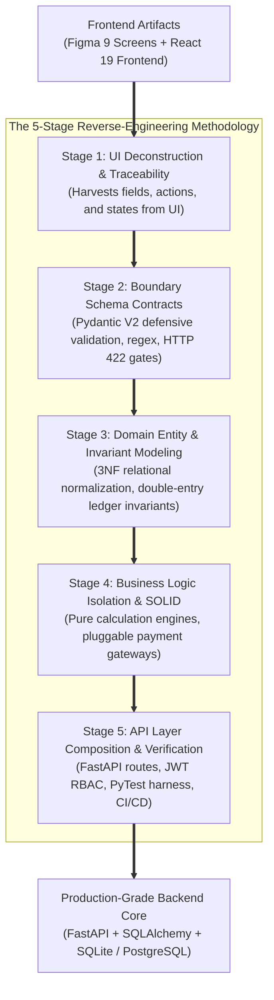
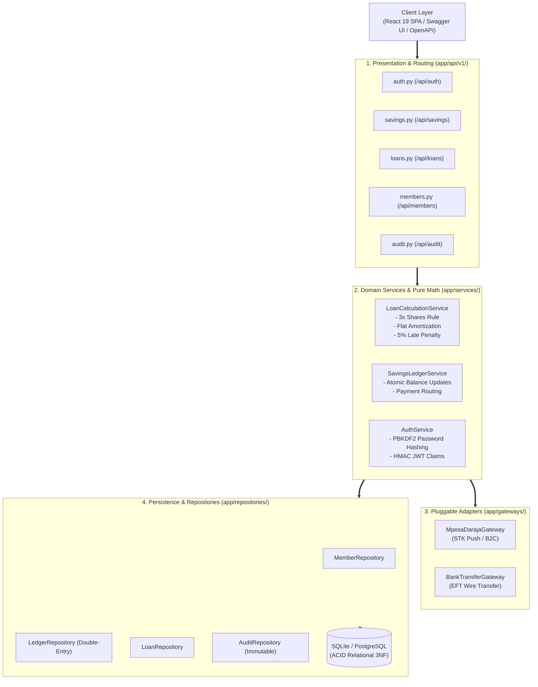

# SACCO Tracker: Backend Engineering & Architecture Master Guide

**Course:** SWE3020B – Software Quality Assurance and Security (USIU-Africa)  
**Deliverable:** CAT 2 System Architecture & Reverse-Engineering Defense (30 Marks)  
**Engineering Team:**
* **Mercy Tryphen** – System Architecture & Backend Infrastructure
* **Jescah Otwoma** – API Contracts & Payment Gateways
* **Nyeliep Nial** – Frontend UI/UX Design & Client Architecture
* **Tayak Ruai** – Software Quality Assurance & Test Engineering
* **Roy Githaiga** – Client Integration & Agile Scrum Facilitator  

---

## 1. Executive Summary: Why and How the Backend Was Done

Traditional software engineering courses often suffer from the **"Smart UI / Fat Controller" anti-pattern**, where student teams embed SQL queries, financial calculations, and third-party payment requests directly inside web route handlers. This produces brittle systems vulnerable to race conditions, arithmetic errors, and security vulnerabilities.

For the **SACCO Digital Savings Tracker**, our backend was reverse-engineered directly from the high-fidelity Figma designs and React frontend through a disciplined **5-Stage Defensive Architectural Derivation**:

---

## 2. Directory Navigation & Documentation Index

To keep the repository root clean, all comprehensive specifications are organized under [`docs/`](file:///c:/Users/user/Documents/Quality%20assurance/SWE-3020-GROUP_PROJECT/docs/):

| Stage / Document | Scope & Purpose | Key Deliverables & Code Mappings |
| :--- | :--- | :--- |
| **[Stage 1: UI Deconstruction](docs/STAGE_1_UI_DECONSTRUCTION_AND_TRACEABILITY.md)** | Deconstructs all 9 screens from Figma and React into data models and user flows. | Field catalog, screen inventory, requirements traceability matrix. |
| **[Stage 2: Boundary Schemas](docs/STAGE_2_BOUNDARY_SCHEMAS_AND_VALIDATION.md)** | Network perimeter defensive validation preventing malformed requests. | [`app/schemas/`](app/schemas/) (Pydantic V2: regex, bounds, HTTP 422 status codes). |
| **[Stage 3: Relational Modeling](docs/STAGE_3_DOMAIN_ENTITY_AND_INVARIANT_MODELING.md)** | Relational 3NF architecture and non-negotiable financial domain invariants. | [`app/models/entities.py`](app/models/entities.py) (Double-entry balance sum, 3x shares rule). |
| **[Stage 4: SOLID Business Logic](docs/STAGE_4_BUSINESS_LOGIC_ISOLATION_AND_SOLID.md)** | Clean Hexagonal Architecture isolating pure math from databases and HTTP. | [`app/services/`](app/services/), [`app/interfaces/`](app/interfaces/), [`app/gateways/`](app/gateways/). |
| **[Stage 5: API Composition](docs/STAGE_5_API_COMPOSITION_AND_VERIFICATION.md)** | Mounting routes, dependency injection, role-based guards, and test execution. | [`app/main.py`](app/main.py), [`tests/`](tests/) (16 automated tests passing in 0.99s). |
| **[Master Engineering Guide](docs/BACKEND_ENGINEERING_AND_SRS_MASTER_GUIDE.md)** | Complete defense guide with talk track, grading rubric mappings, and Q&A prep. | Rubric ownership, presentation timing, defense strategies. |
| **[Formal SRS Specification](docs/BACKEND_ENGINEERING_FORMAL_SPECIFICATION.md)** | IEEE-compliant System Requirements Specification (SRS) for CAT 2 evaluation. | 10 Functional Requirements (FR-01 to FR-10), non-functional constraints. |
| **[Agile Jira Simulation](docs/PROJECT_MANAGEMENT_JIRA.md)** | Sprint timeline, task registers, and Kanban board tickets (SACCO-101 to SACCO-125). | Team role allocation, burndown velocity, sprint milestones. |
| **[Peer Code Review Register](docs/PEER_CODE_REVIEW_REGISTER.md)** | Evidence of collaborative code reviews, PR vetting, and bug resolutions. | PR #1 and PR #2 peer feedback, destructuring fix, audit trail. |

---

## 3. High-Level Architecture: Clean Layered Design

The backend is partitioned into 4 decoupled horizontal layers:

---

## 4. The 5 SOLID Software Design Principles (Direct Rubric Evidence)

| Principle | Architectural Implementation in Code | File Location |
| :--- | :--- | :--- |
| **Single Responsibility (SRP)** | `LoanCalculationService` executes financial formulas only; it contains zero SQL queries and zero HTTP logic. | [`app/services/loan_service.py`](app/services/loan_service.py) |
| **Open/Closed (OCP)** | Defined abstract `IPaymentGateway`. New payment channels (Airtel Money, Pesalink) are added without altering core ledger code. | [`app/interfaces/payment.py`](app/interfaces/payment.py) |
| **Liskov Substitution (LSP)** | `MpesaDarajaGateway` and `BankTransferGateway` can be substituted interchangeably; both return standardized `PaymentResult` dataclasses. | [`app/gateways/mpesa_gateway.py`](app/gateways/mpesa_gateway.py) |
| **Interface Segregation (ISP)** | Role-specific contracts (`ILoanCalculator`, `IPaymentGateway`, `IBaseRepository`) rather than a monolithic god-interface. | [`app/interfaces/`](app/interfaces/) |
| **Dependency Inversion (DIP)** | API route handlers depend on abstractions; concrete instances are injected at runtime via FastAPI's `Depends()` provider. | [`app/api/v1/endpoints/`](app/api/v1/endpoints/) |

---

## 5. Automated Verification & Quality Assurance

* **PyTest Test Suite:** 16 unit and integration test suites passing in **0.99s** (`tests/unit/`, `tests/integration/`).
* **Static Code Analysis:** **Flake8** zero-defect compliance (0 errors, 0 warnings, PEP 8 enforced).
* **CI/CD Automation:** Executed automatically on every push and pull request via [GitHub Actions CI](.github/workflows/backend-ci.yml).
