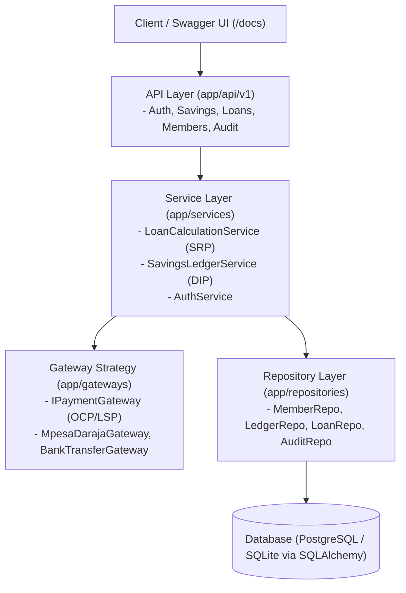

# Sacco Digital Savings Tracker

[](https://github.com/Mercy-Em-t/SWE-3020-GROUP_PROJECT/actions)


-brightgreen)

**Course:** SWE3020B – Software Quality Assurance and Security  
**Institution:** United States International University - Africa (USIU-Africa)  
**Deliverable:** CAT 2 Final Semester Project Evaluation (30 Marks)  
**Figma Prototype:** [Sacco Savings System (Figma)](https://www.figma.com/design/mrBDA59k1Vn7Vf9gBUNIsf/Sacco-Savings-System?node-id=0-1)  
**Project Documentation:** [Google Docs Deliverable](https://docs.google.com/document/d/1q0cNigAZFkwCNmpLJC_DqFBDRbX2gCFz1OqVTH0uMys/edit?usp=sharing)  

---

## 1. Project Team Roster & Role Allocations

| Name | Student ID | Primary Responsibilities |
| :--- | :--- | :--- |
| **Mercy Tryphen (Lead)** | 674748 | System Architecture, Database Schema Engineering, FastAPI Scaffolding, GitHub Actions CI/CD Pipeline. |
| **Jescah Otwoma** | 673748 | RESTful API Development, Payment Gateway Strategy Integration (M-Pesa Daraja), Financial Ledger Invariants. |
| **Nyeliep Nial** | 673176 | Figma High-Fidelity UI/UX Prototyping, Usability Engineering (WCAG 2.1), React Frontend Implementation & Component Specifications. |
| **Tayak Ruai** | 671649 | Quality Assurance Strategy, PyTest Unit & Integration Test Automation, Formal Use Case Modeling. |
| **Roy** | – | Client State Management, API Integration Protocols, Jira Agile Facilitation, Wednesday Presentation. |

---

## 2. Reverse-Engineered Architecture & 5-Stage Methodology

The backend was reverse-engineered directly from the frontend prototypes and business requirements across a rigorous 5-stage architectural pipeline:

* 📘 **Master Architecture Guide:** [`ARCHITECTURE.md`](ARCHITECTURE.md)
* 📑 **Stage 1: UI Deconstruction & Traceability:** [`docs/STAGE_1_UI_DECONSTRUCTION_AND_TRACEABILITY.md`](docs/STAGE_1_UI_DECONSTRUCTION_AND_TRACEABILITY.md)
* 🛡️ **Stage 2: Boundary Schema Contracts:** [`docs/STAGE_2_BOUNDARY_SCHEMAS_AND_VALIDATION.md`](docs/STAGE_2_BOUNDARY_SCHEMAS_AND_VALIDATION.md)
* 🗄️ **Stage 3: Domain Entity & Invariant Modeling:** [`docs/STAGE_3_DOMAIN_ENTITY_AND_INVARIANT_MODELING.md`](docs/STAGE_3_DOMAIN_ENTITY_AND_INVARIANT_MODELING.md)
* ⚙️ **Stage 4: Business Logic Isolation & SOLID:** [`docs/STAGE_4_BUSINESS_LOGIC_ISOLATION_AND_SOLID.md`](docs/STAGE_4_BUSINESS_LOGIC_ISOLATION_AND_SOLID.md)
* 🚀 **Stage 5: API Composition & Verification:** [`docs/STAGE_5_API_COMPOSITION_AND_VERIFICATION.md`](docs/STAGE_5_API_COMPOSITION_AND_VERIFICATION.md)



### SOLID Principles Mapping (11 Marks)
* **Single Responsibility Principle (SRP):** `LoanCalculationService` strictly computes financial math (3x shares multiplier, amortization, late fees) without touching database sessions or HTTP requests.
* **Open/Closed Principle (OCP):** Payment operations consume `IPaymentGateway` interface. New payment rails (Airtel, Bank Wire) are added without altering `SavingsLedgerService`.
* **Liskov Substitution Principle (LSP):** `MpesaDarajaGateway` and `BankTransferGateway` can be substituted interchangeably into services and test doubles without altering caller behavior.
* **Interface Segregation Principle (ISP):** Segregated, lean contracts (`IPaymentGateway`, `ILoanCalculator`, `IBaseRepository`).
* **Dependency Inversion Principle (DIP):** FastAPI dependency injection (`Depends`) supplies repositories and calculation services to route controllers.

---

## 3. Frontend (React + Vite)

The web client implements the Figma prototype as a React single-page application with role-based screens for **members** and **treasurers/admins**. It lives in the [`frontend/`](frontend/) folder.

| Role | Screens |
| :--- | :--- |
| Everyone | Login, Register |
| Member | Dashboard, Deposits, Savings & Dividends, Loan Application, Statements |
| Treasurer / Admin | Group Dashboard, Deposits & Reconciliation, Loan Approvals, Member Register, Audit Trail & Statements |

### Frontend Structure
```
frontend/src/
├─ api/          # all backend calls (auth, ...) in one place
├─ components/   # reusable UI: AppShell, Sidebar, Card, DataTable, StatusTag, Stepper, Meter
├─ pages/        # auth/, member/, admin/ screens built from the components
├─ routes/       # ProtectedRoute (role-based page access)
├─ utils/        # pure logic: loan rules, formatting, validation (unit tested)
├─ config/       # product name, navigation per role
├─ data/         # placeholder data, replaced by API calls as endpoints are connected
└─ styles/       # design tokens (colours, fonts) from the Figma file
```

* **Modularity & reusability:** pages are composed from shared components, so a change to `DataTable` or `StatusTag` updates every screen.
* **Separation of concerns (SRP):** business rules such as the 3× shares borrowing limit and guarantor check are pure functions in `utils/loan.js`, kept out of the UI code.
* **Open/Closed:** `DataTable` takes column definitions, so new columns are added without editing the component.
* **Dependency inversion:** pages call the `api` module instead of `fetch` directly, so switching from placeholder data to the FastAPI backend does not change the pages.
* **Role-based access:** `ProtectedRoute` shows members and admins only their own pages. This is a UI convenience; the backend remains responsible for enforcing permissions.

### Accessibility & Usability
* Every form field has a label, validation errors are announced to screen readers (`role="alert"`), and keyboard focus is visible.
* Statuses use text labels as well as colour (Matched, Pending, Approved, Rejected).
* Primary and secondary text meet the WCAG 2.1 AA contrast ratio of 4.5:1.
* The loan application shows its progress with a stepper (Eligibility → Details → Guarantors → Treasurer review).

### Run the Frontend
```bash
cd frontend
npm install
npm run dev        # http://localhost:5173
```

### Frontend Tests
```bash
npm test           # Vitest + React Testing Library
npm run lint
npm run build
```
33 automated tests cover the loan rules (borrowing limit, guarantors), form validation, role-based route protection, loan approve/reject, and a smoke test that every page renders.

## 4. Quick Start & Local Execution

### Prerequisites
* Python 3.11+
* Git

### Installation
```bash
# Clone the repository
git clone https://github.com/Mercy-Em-t/SWE-3020-GROUP_PROJECT.git
cd SWE-3020-GROUP_PROJECT

# Install dependencies
pip install -r requirements.txt
```

### Launch the Development Server
```bash
uvicorn app.main:app --reload --port 8000
```
* **API Home:** `http://127.0.0.1:8000/`
* **Interactive Swagger UI (Live Demo):** `http://127.0.0.1:8000/docs`
* **ReDoc Documentation:** `http://127.0.0.1:8000/redoc`

---

## 5. Quality Assurance & Automated Testing

### Execute the PyTest Suite
```bash
pytest -v
```

### Execute Code Quality & Linting Check (flake8)
```bash
flake8 app tests --count --statistics
```

### Test Coverage Highlights (16 Automated Tests)
* **Unit Tests:** Mathematical validation of borrowing limits ($Limit = 3 \times Shares$), amortization schedules, guarantor coverage sufficiency, and delinquency grace period penalty enforcement.
* **Integration Tests:** Complete end-to-end user journey from member registration, M-Pesa savings deposit, borrowing threshold validation, loan application with guarantors, repayment deduction, to append-only audit trail verification.

---

## 6. Project Management & Jira Kanban Board

The team tracks deliverables using Jira Software across five active stages:
```
[ Backlog ] ➔ [ To Do ] ➔ [ In Progress ] ➔ [ Peer Code Review (PR) ] ➔ [ QA / Test Gate ] ➔ [ Done ]
```
See detailed sprint breakdowns, user stories, and burndown progression in [`docs/PROJECT_MANAGEMENT_JIRA.md`](docs/PROJECT_MANAGEMENT_JIRA.md).
