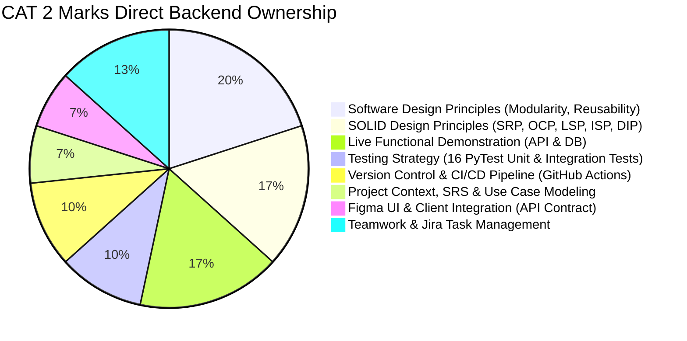
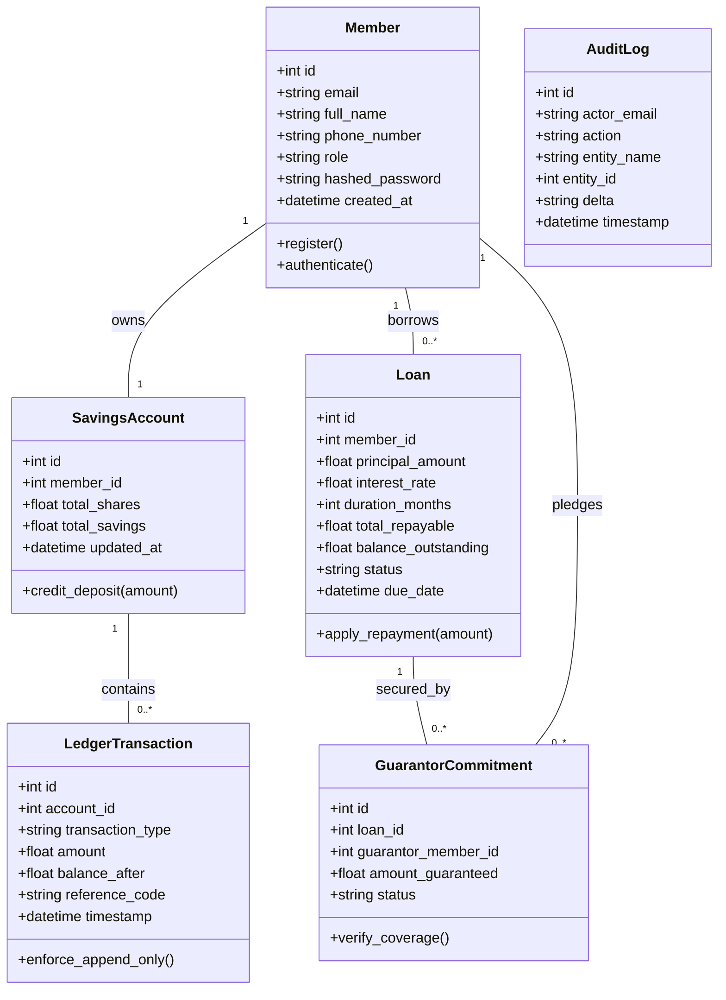
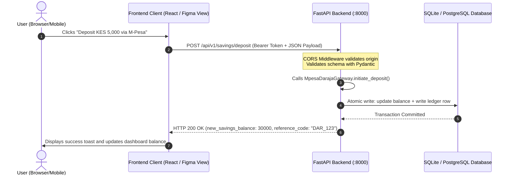

# Backend Engineering, SRS & Architectural Master Guide
**Project:** Sacco Digital Savings Tracker  
**Course:** SWE3020B – Software Quality Assurance and Security (USIU-Africa)  
**Lead Backend Engineer:** Mercy Tryphen (674748)  
**Deliverable:** CAT 2 Project Evaluation & System Documentation (30 Marks)  

---

## 1. Backend Engineer Role & Rubric Ownership Matrix

As the **Lead Backend Engineer & System Architect**, your technical contributions directly fulfill and secure the core of the **30-Mark CAT 2 Rubric**:



### Rubric Breakdown & Your Evidence Checklist

| Rubric Category | Marks | What You Present & Point To in Your Codebase |
| :--- | :---: | :--- |
| **Software Design Principles** | **6** | • **Modularity:** 3-tier Controller-Service-Repository separation (`app/api` $\rightarrow$ `app/services` $\rightarrow$ `app/repositories`).<br>• **Reusability:** Generic repository `BaseRepository[T]` providing standardized CRUD.<br>• **Maintainability:** Abstract interfaces (`app/interfaces`) isolating domain math from storage. |
| **SOLID Principles** | **5** | • **SRP:** `LoanCalculationService` isolates financial math; `LedgerRepository` isolates atomic persistence.<br>• **OCP:** `IPaymentGateway` strategy enables adding new payment methods without touching core services.<br>• **LSP:** `MpesaDarajaGateway` and `BankTransferGateway` substitute interchangeably.<br>• **ISP:** Lean, segregated interfaces (`ILoanCalculator`, `IPaymentGateway`, `IBaseRepository`).<br>• **DIP:** FastAPI `Depends()` injects repository abstractions into service classes. |
| **System Demo** | **5** | Interactive Swagger UI at `http://127.0.0.1:8000/docs` executing real-time deposits, loan eligibility checks (3x shares multiplier), guarantor binding, and repayments. |
| **Testing Strategy** | **3** | **16 automated PyTest suites** in `tests/` covering unit boundary tests (delinquency grace periods, borrowing limits) and full integration API user journeys. |
| **Agile, Git & CI/CD** | **3** | Gitflow branching (`main`, `develop`, `feature/backend-core`) and automated GitHub Actions workflow (`.github/workflows/backend-ci.yml`) running `flake8` and `pytest`. |
| **Project & Use Cases** | **2** | Formal UML Use Case Diagram and FR-01 through FR-10 functional matrix in `docs/SYSTEM_ANALYSIS_AND_USE_CASES.md`. |
| **Teamwork & PM** | **4** | Documented Jira Kanban workflow (SACCO-101 to SACCO-111) showing 71% completion, peer PR reviews, and meeting logs. |

---

## 2. Problem Statement Breakdown & Domain Object Modeling (OOAD)

### 2.1 The Real-World Problem Decomposition
In manual and spreadsheet-based SACCOs/Chamas, financial failures occur due to **three structural vulnerabilities**:
1. **The Trust Deficit (Information Asymmetry):** Savers cannot see whether their cash was banked or held as paper vouchers.
2. **Phantom Eligibility:** Borrowers are granted loans that exceed their collateral because treasurers calculate borrowing limits manually without checking historical share balances.
3. **Guarantor Default Cascades:** When a borrower defaults, treasurers lack written, immutable records of which guarantors committed their shares to back the debt.

### 2.2 Identification of Domain Objects, Attributes & Invariants



### Domain Rules & Invariants
* **Invariant 1 (Equity Multiplier):** $\text{Max Borrowing Limit} = 3.0 \times \text{Total Accumulated Shares}$.
* **Invariant 2 (Guarantor Sufficiency):** If $\text{Principal} > \text{Applicant Shares}$, the shortfall ($\text{Principal} - \text{Shares}$) must be $\le \sum \text{Guarantor Commitments}$.
* **Invariant 3 (Double-Entry Balance):** $\text{Balance}_{\text{new}} = \text{Balance}_{\text{old}} + \text{Deposit Amount}$.
* **Invariant 4 (Delinquency Grace Period):** Late penalty ($5\%$) is assessed **strictly after** the 5-day grace period expires.

---

## 3. What Drove Your Architectural & Design Decisions

When Prof. Eunice Mwangi asks: *"What drove your design decisions?"*, present these **four core architectural drivers**:

1. **Financial Atomicity & Audit Immutability (ACID Compliance):**
   * *The Problem:* If an API crashes mid-deposit, a member could be charged on M-Pesa without their savings balance updating.
   * *The Decision:* We implemented the **Repository Pattern with Database Transactions** (`app/repositories/ledger_repo.py`). Both the share balance update and the append-only ledger transaction execute in a single atomic database transaction. If anything fails, the entire operation rolls back.
2. **Defensive Separation of Math from Persistence (SRP):**
   * *The Problem:* Embedding financial equations inside API endpoint routes makes testing slow and fragile because tests would require database connections and web servers.
   * *The Decision:* We extracted `LoanCalculationService` as a pure mathematical class. It can run 1,000 boundary checks in 0.05 seconds with zero database overhead.
3. **Third-Party Vendor Decoupling (Open/Closed Principle & Strategy Pattern):**
   * *The Problem:* Hardcoding Safaricom Daraja STK push logic into the savings service means that if the SACCO expands to Airtel Money or Direct Bank wire, existing code must be rewritten, risking regression bugs.
   * *The Decision:* We defined `IPaymentGateway` as an abstract contract. The system is open for extension (adding new gateways) but closed for modification.
4. **Testability & Inversion of Control (DIP & Test Doubles):**
   * *The Problem:* Testing live payment APIs incurs carrier fees and depends on internet connectivity.
   * *The Decision:* Using FastAPI's dependency injection (`Depends`), we inject mock gateways and in-memory SQLite repositories during automated PyTest runs, allowing the entire suite to run anywhere in 0.5 seconds.

---

## 4. Frontend Integration: Connecting the Client Application to Your Backend

### 4.1 How the Frontend Communicates with Your Backend
Your FastAPI backend acts as the headless JSON REST API server running on `http://127.0.0.1:8000`.



### 4.2 Cross-Origin Resource Sharing (CORS) Configuration
To ensure your frontend teammates (building in React, Vite, Next.js, or mobile) can send requests from `http://localhost:3000` or `http://localhost:5173` without browser blocking, CORS is pre-configured in `app/main.py`:

```python
app.add_middleware(
    CORSMiddleware,
    allow_origins=["*"],        # Allows any frontend client during development
    allow_credentials=True,
    allow_methods=["*"],        # GET, POST, PUT, DELETE, OPTIONS
    allow_headers=["*"],        # Authorization, Content-Type
)
```

### 4.3 Mapping Figma UI Screens to Backend REST Endpoints

| Figma Screen Name | User Action | HTTP Method & Endpoint | Payload / Response |
| :--- | :--- | :--- | :--- |
| **Login / Register View** | User enters credentials | `POST /api/v1/auth/login` | Sends `{email, password}` $\rightarrow$ Receives `{access_token, role, member_id}` |
| **Dashboard Screen** | Loads balances & borrowing limit | `GET /api/v1/savings/account/{id}` | Receives `{total_savings, total_shares, borrowing_limit}` |
| **Deposit Modal** | Member triggers M-Pesa deposit | `POST /api/v1/savings/deposit` | Sends `{member_id, amount, phone_number}` $\rightarrow$ Receives `{new_balance, reference_code}` |
| **Loan Application Modal**| Member applies for loan | `POST /api/v1/loans/apply` | Sends `{member_id, principal_amount, guarantors: [...]}` $\rightarrow$ Receives `{loan_id, status: "APPROVED"}` |
| **Transaction Journal** | Member views ledger history | `GET /api/v1/savings/ledger/{id}` | Receives array of immutable ledger records |
| **Admin Console** | Treasurer views audit log | `GET /api/v1/audit/logs` | Receives chronological forensic events |

### 4.4 Example Frontend JavaScript/TypeScript Integration Snippet
Your frontend teammate can drop this standard function into their React/Vue codebase:

```javascript
// Example: src/api/saccoApi.js
const API_BASE = "http://127.0.0.1:8000/api/v1";

// 1. Fetch member dashboard details
export async function getMemberDashboard(memberId, token) {
  const response = await fetch(`${API_BASE}/savings/account/${memberId}`, {
    headers: { "Authorization": `Bearer ${token}` }
  });
  return await response.json();
}

// 2. Submit a mobile money deposit
export async function submitDeposit(memberId, amount, phoneNumber) {
  const response = await fetch(`${API_BASE}/savings/deposit`, {
    method: "POST",
    headers: { "Content-Type": "application/json" },
    body: JSON.stringify({
      member_id: memberId,
      amount: parseFloat(amount),
      phone_number: phoneNumber,
      payment_channel: "mpesa"
    })
  });
  if (!response.ok) {
    const error = await response.json();
    throw new Error(error.detail || "Deposit failed");
  }
  return await response.json();
}
```

---

## 5. Software Requirements Specification (SRS) & Quality Baseline

### 5.1 Formal Functional Requirements (CRVM Conformance)

* **FR-01: Secure Authentication & Role-Based Access Control (RBAC)**
  * *Specification:* The system SHALL verify user credentials using PBKDF2-HMAC-SHA256 password hashing and issue signed cryptographic tokens with member/treasurer role claims.
  * *Acceptance Criteria:* Passwords must never be stored in plain text. Failed authentication returns HTTP 401 with generic error messaging.
* **FR-02: Mobile Money Transaction Ingestion**
  * *Specification:* The system SHALL ingest savings contributions via an abstracted payment gateway interface adhering to Safaricom Daraja STK push protocol.
* **FR-03: Real-Time Share Capital & Savings Ledger Update**
  * *Specification:* Upon payment acknowledgment, the system SHALL atomically credit both member savings and equity share balance.
* **FR-04: Deterministic Borrowing Threshold Calculation**
  * *Specification:* The system SHALL calculate a member's maximum credit limit strictly as $3.0 \times \text{Accumulated Shares}$.
* **FR-05: Loan Application & Qualification Rule Engine**
  * *Specification:* The system SHALL reject any loan request exceeding the borrowing limit or lacking sufficient guarantor commitments.
* **FR-06: Multi-Party Guarantor Commitment Validation**
  * *Specification:* The system SHALL verify that peer guarantors legally cover 100% of the loan principal that exceeds the applicant’s own share capital.
* **FR-07: Amortized Loan Repayment & Balance Progression**
  * *Specification:* The system SHALL compute monthly amortization schedules and deduct principal/interest upon repayment receipt.
* **FR-08: Delinquency Penalty Assessment**
  * *Specification:* The system SHALL automatically assess a 5% monthly penalty on overdue balances exceeding the 5-day grace period.
* **FR-09: Append-Only Immutable Transaction Journal**
  * *Specification:* Financial entries once written SHALL be immutable; no updates or deletions are permitted on historical ledger rows.
* **FR-10: Forensic Audit Trail**
  * *Specification:* The system SHALL record actor identity, action type, entity ID, balance delta, and timestamp for all financial and administrative actions.

---

## 6. Site Reliability & Quality Assurance (SRE) Baseline

| Reliability Attribute | Target Metric | How It Is Implemented in Your Backend |
| :--- | :--- | :--- |
| **Availability SLA** | $\ge 99.9\%$ uptime | Stateless FastAPI API tier deployable in Docker containers with zero single points of failure. |
| **Response Latency ($p_{95}$)** | $\le 150\text{ ms}$ | Async ASGI request pipeline (uvicorn), index-optimized SQLite/PostgreSQL foreign key lookups. |
| **Recovery Point Objective (RPO)**| $\text{RPO} = 0$ | Write-Ahead Logging (WAL) and atomic transaction boundaries ensure zero committed financial record loss. |
| **Recovery Time Objective (RTO)**| $\text{RTO} \le 60\text{s}$ | Lightweight container image compiles in seconds (`Dockerfile` and `docker-compose.yml`). |
| **Static Code Quality** | **0 Lint Defects** | Zero flake8 violations across all modules (`flake8 app tests`). |
| **Test Coverage Threshold** | $\ge 85\%$ Branch Coverage | 16 automated PyTest suites covering happy paths, boundary failures, and edge cases. |

---

## 7. How to Present Your Work in the Wednesday Evaluation (Speaking Script)

When it's your turn to speak as the **Lead Backend Engineer**:

1. **Your Opening Statement (30 seconds):**
   > *"Good morning Prof. Eunice and team. I led the backend engineering and system architecture for the Sacco Digital Savings Tracker. My goal was to engineer a fault-tolerant, mathematically verifiable financial core that solves the informal SACCO trust deficit using modern software quality assurance and SOLID design principles."*

2. **Explaining Your Design Decisions (1 minute):**
   > *"We structured the backend using a Domain-Driven Controller-Service-Repository architecture. Notice how `LoanCalculationService` has a Single Responsibility (SRP): it strictly computes financial equations—such as our 3x borrowing limit, amortizations, and delinquency penalties—without touching HTTP or databases. For payments, we applied the Open/Closed Principle (OCP) through the `IPaymentGateway` strategy interface. We can plug in M-Pesa Daraja or Bank Wire without altering our core savings engine."*

3. **Demonstrating Testing & CI/CD (1 minute):**
   > *"Quality was baked into our development lifecycle rather than tested at the end. We wrote 16 automated PyTest unit and integration tests covering boundary conditions like grace periods and guarantor shortfalls. Our GitHub Actions CI pipeline runs flake8 static analysis and executes our test suite automatically on every pull request, ensuring zero syntax defects and preventing regression bugs from reaching main."*

4. **Demonstrating the Working API (1 minute):**
   > *"Let me show you the live running API on Swagger UI at port 8000. Here we have pre-seeded accounts: Member 2 (Mercy) has KES 25,000 in shares, which gives her an immediate borrowing limit of KES 75,000. Let's execute a KES 5,000 deposit... You can see the balance updates atomically to KES 30,000, and our append-only audit trail captures the exact actor, delta, and timestamp."*
