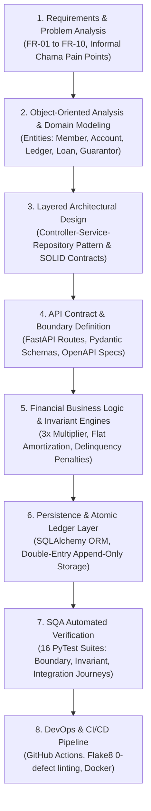
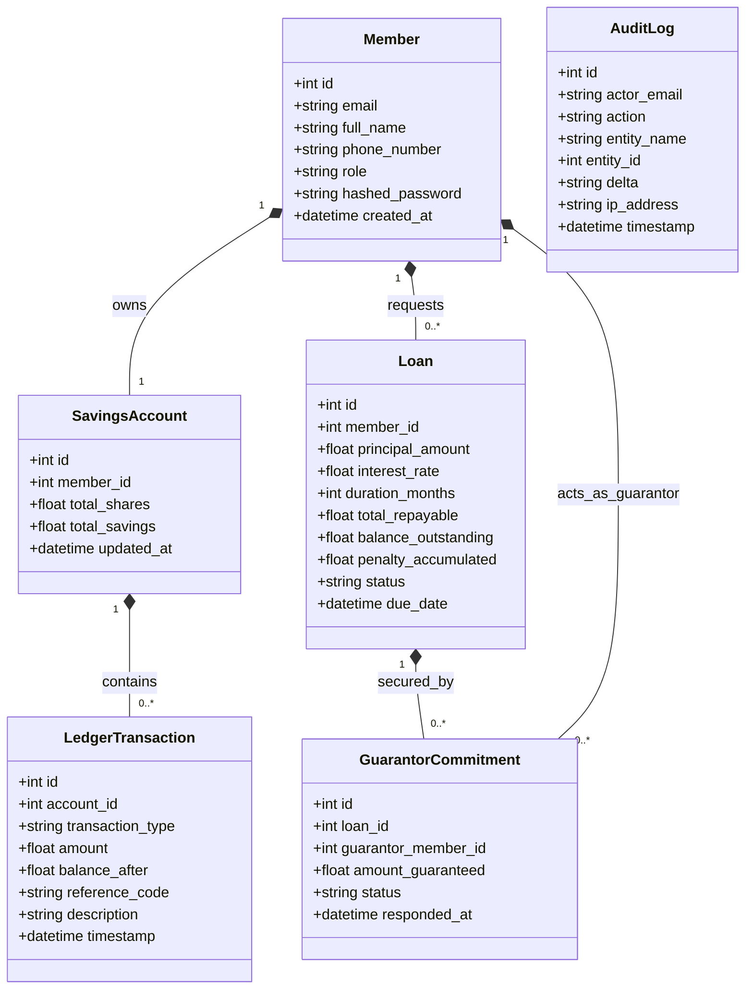
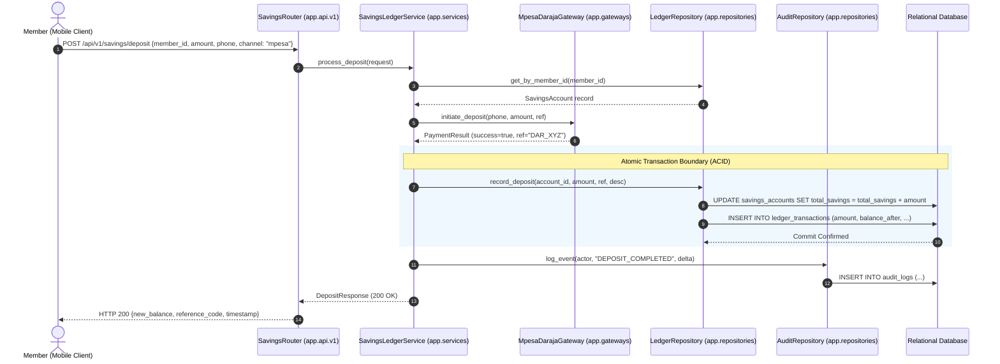
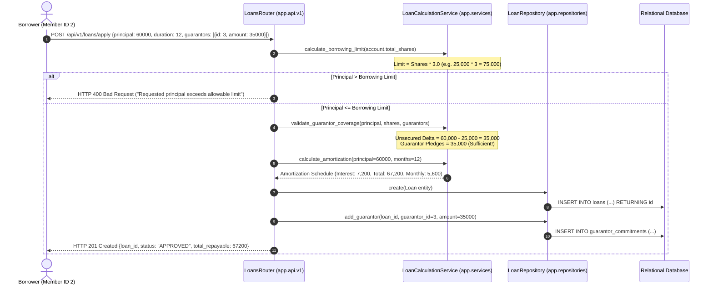
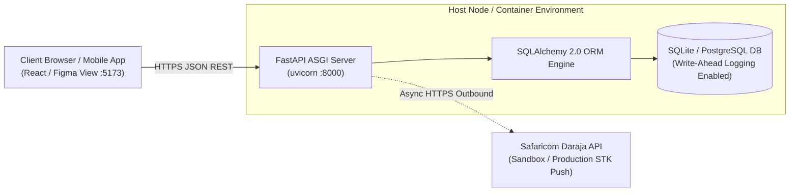

# Formal Backend Engineering Architecture & Technical Design Document (TDD)

**System:** Sacco Digital Savings Tracker API  
**Course:** SWE3020B – Software Quality Assurance and Security (USIU-Africa)  
**Governing Standards:** IEEE 42010:2022 (Architecture Description), ISO/IEC 25010:2023 (Systems & Software Quality), RFC 2119  
**Lead System Architect & Backend Engineer:** Mercy Tryphen (674748)  
**Document Version:** 1.0.0 (Release Candidate – CAT 2 Evaluation)  

---

## 1. Executive Architecture Summary & Transition Roadmap

### 1.1 Engineering Vision
The Sacco Digital Savings Tracker backend provides a secure, fault-tolerant, and mathematically verifiable financial core. It transitions community-based savings and credit cooperatives (SACCOs/chamas) from vulnerable paper books and spreadsheets into an automated, double-entry transactional engine.

### 1.2 Transition Roadmap: From Requirements to Concrete Implementation



---

## 2. Kruchten 4+1 Architectural Views

### 2.1 Logical View (Domain Class & Structural Subsystems)

The backend follows the **Layered Clean Architecture (Controller-Service-Repository)** pattern, enforcing strict unidirectional dependency inward:



---

### 2.2 Process View (Dynamic Sequence Diagrams)

#### A. Mobile Money Contribution & Double-Entry Ledger Ingestion
This flow illustrates how an incoming payment request is validated, passed to the payment strategy, and atomically written to the ledger:



---

#### B. Loan Application, Borrowing Limit Check & Guarantor Validation
This flow models the rule-based credit qualification and multi-party guarantor binding:



---

### 2.3 Development View (Package Modularization & Invariants)

The codebase strictly enforces David Parnas' **Information Hiding** and Package Decoupling:

```
SWE-3020-GROUP_PROJECT/
├── app/
│   ├── api/v1/                   # Presentation Tier (HTTP serialization, route handlers)
│   │   ├── endpoints/
│   │   │   ├── auth.py           # Identity, JWT login, registration (FR-01)
│   │   │   ├── savings.py        # Contributions, account summaries, ledger journals (FR-02, FR-03, FR-09)
│   │   │   ├── loans.py          # Credit eligibility, loan origination, repayments (FR-04, FR-05, FR-06, FR-07)
│   │   │   └── audit.py          # Append-only forensic journal queries (FR-10)
│   │   └── router.py             # Master API router mounting v1 endpoints
│   ├── core/                     # Infrastructure Foundations
│   │   ├── config.py             # Pydantic BaseSettings & financial system defaults
│   │   ├── database.py           # SQLAlchemy declarative engine & scoped session lifecycle
│   │   └── security.py           # PBKDF2 cryptography, password salting, HMAC token signing
│   ├── interfaces/               # Behavioral Contracts (ISP / DIP)
│   │   ├── payment.py            # IPaymentGateway strategy abstraction
│   │   ├── loan_calculator.py    # ILoanCalculator pure domain math abstraction
│   │   └── repository.py         # IBaseRepository[T] generic persistence abstraction
│   ├── gateways/                 # Concrete External Adapters (OCP / LSP)
│   │   ├── mpesa_gateway.py      # Safaricom Daraja STK Push implementation
│   │   └── bank_gateway.py       # Direct Bank Wire/EFT implementation
│   ├── models/                   # Relational Domain Entities
│   │   └── entities.py           # Declarative models: Member, Account, Ledger, Loan, Guarantor, AuditLog
│   ├── repositories/             # Data Access Objects (DAO)
│   │   ├── base.py               # Generic CRUD repository
│   │   ├── member_repo.py        # Member & credential queries
│   │   ├── ledger_repo.py        # Atomic double-entry balance and ledger operations
│   │   ├── loan_repo.py          # Loan lifecycle, repayments, and guarantor state
│   │   └── audit_repo.py         # Non-repudiation audit event insertion
│   ├── schemas/                  # Boundary Contracts (Pydantic V2)
│   │   ├── member.py             # User registration & token schemas
│   │   ├── savings.py            # DepositRequest, AccountSummary, LedgerJournal schemas
│   │   ├── loan.py               # LoanApplicationRequest, Amortization, Repayment schemas
│   │   └── audit.py              # AuditLogResponse schema
│   ├── services/                 # Pure Business Domain Logic (SRP)
│   │   ├── auth_service.py       # Credential verification & session lifecycle
│   │   ├── loan_service.py       # LoanCalculationService (Math, borrowing limits, delinquency penalties)
│   │   └── savings_service.py    # SavingsLedgerService (Orchestrating gateways and repositories)
│   ├── main.py                   # FastAPI Application Scaffolding, CORS & OpenAPI Documentation
│   └── seed.py                   # Evaluation Database Seeder (Pre-populates demo accounts)
├── docs/                         # Engineering Documentation & Rubric Deliverables
├── tests/                        # SQA Automated Verification Suite
│   ├── conftest.py               # In-memory SQLite StaticPool & FastAPI TestClient fixtures
│   ├── unit/                     # Deterministic unit tests (Loan math, invariants, boundary rules)
│   └── integration/              # Full user journey integration tests
├── .github/workflows/            # Continuous Integration & Delivery
│   └── backend-ci.yml            # GitHub Actions automated lint & test pipeline
├── Dockerfile                    # Containerization specification
├── docker-compose.yml            # Local orchestration
└── requirements.txt              # Pinned production dependencies
```

---

### 2.4 Physical & Deployment View



---

## 3. SOLID Design Principles Mathematical & Code Mapping

### 3.1 Single Responsibility Principle (SRP)
* **Definition:** A module `M` MUST have exactly one cohesive business reason to undergo modification ($|\text{Responsibilities}(M)| = 1$).
* **System Mapping:**
  * `LoanCalculationService`: Exclusively calculates borrowing capacity, monthly amortization curves, and delinquency fee penalties. It does **not** communicate with databases, send notifications, or parse HTTP headers.
  * `LedgerRepository`: Exclusively persists financial delta records and enforces append-only storage invariants.
  * `AuthService`: Exclusively computes cryptographic credential hashes and signs access tokens.

---

### 3.2 Open/Closed Principle (OCP)
* **Definition:** Software entities SHALL be open for functional extension without requiring source code modifications to existing stable modules.
* **System Mapping:**
  * The payment layer declares the `IPaymentGateway` interface in `app/interfaces/payment.py`:
    $$\text{SavingsLedgerService} \longrightarrow \text{IPaymentGateway} \longleftarrow \{\text{MpesaDarajaGateway}, \text{BankTransferGateway}\}$$
  * Introducing an Airtel Money or Stripe adapter requires only creating a new class implementing `IPaymentGateway`. `SavingsLedgerService` remains completely unchanged.

---

### 3.3 Liskov Substitution Principle (LSP)
* **Definition:** Let $\phi(x)$ be a property provable about objects $x$ of type $T$. Then $\phi(y)$ SHALL be true for objects $y$ of type $S$ where $S$ is a subtype of $T$.
* **System Mapping:**
  * Any implementation of `IPaymentGateway` guarantees that `initiate_deposit(phone, amount, ref)` returns a valid `PaymentResult` object with non-null `transaction_reference`.
  * During automated PyTest runs, `MockPaymentGateway` substitutes for `MpesaDarajaGateway` transparently without altering service logic.

---

### 3.4 Interface Segregation Principle (ISP)
* **Definition:** Clients SHALL NOT be forced to depend upon interface methods they do not utilize.
* **System Mapping:**
  * We avoid monolithic service contracts. Interfaces are segregated into granular, single-purpose roles:
    * `IPaymentGateway`: Strictly payment processing (`initiate_deposit`, `disburse_funds`).
    * `ILoanCalculator`: Strictly mathematical evaluation (`calculate_borrowing_limit`, `calculate_delinquency_penalty`).
    * `IBaseRepository[T]`: Strictly generic CRUD queries (`get_by_id`, `list_all`, `create`).

---

### 3.5 Dependency Inversion Principle (DIP)
* **Definition:** High-level policy modules SHALL NOT depend upon low-level utility modules. Both SHALL depend upon abstractions.
* **System Mapping:**
  * `SavingsLedgerService` does not instantiate `LedgerRepository()` or `MpesaDarajaGateway()`. It receives them as abstract parameters in its constructor:
    ```python
    class SavingsLedgerService:
        def __init__(self, payment_gateway: IPaymentGateway, ledger_repo: LedgerRepository, audit_repo: AuditRepository):
            self.gateway = payment_gateway
            self.ledger_repo = ledger_repo
            self.audit_repo = audit_repo
    ```
  * In route controllers, FastAPI's `Depends()` dependency injection wires these abstractions at runtime.

---

## 4. Comprehensive RESTful API Contract Specification

All endpoints are prefixed with `/api/v1` and document interactive Swagger schemas at `/docs`.

### 4.1 Authentication & Identity Endpoints (`/auth`)

#### `POST /api/v1/auth/register`
* **Purpose:** Register a new SACCO member or administrative user.
* **Request Schema (`MemberRegisterRequest`):**
  ```json
  {
    "email": "user@sacco.org",
    "full_name": "Jane Doe",
    "phone_number": "+254712345678",
    "password": "SecurePassword123!",
    "role": "member"
  }
  ```
* **Success Response (HTTP 201 Created):**
  ```json
  {
    "id": 1,
    "email": "user@sacco.org",
    "full_name": "Jane Doe",
    "phone_number": "+254712345678",
    "role": "member",
    "created_at": "2026-10-26T10:00:00Z"
  }
  ```
* **Error Response (HTTP 400 Bad Request):**
  ```json
  { "detail": "Email user@sacco.org is already registered." }
  ```

---

#### `POST /api/v1/auth/login`
* **Purpose:** Authenticate credentials and receive a signed JWT Bearer Token.
* **Request Schema (`MemberLoginRequest`):**
  ```json
  {
    "email": "user@sacco.org",
    "password": "SecurePassword123!"
  }
  ```
* **Success Response (HTTP 200 OK):**
  ```json
  {
    "access_token": "eyJhbGciOiJIUzI1NiIsInR5cCI...",
    "token_type": "bearer",
    "role": "member",
    "email": "user@sacco.org",
    "member_id": 1
  }
  ```

---

### 4.2 Transactional Savings & Ledger Endpoints (`/savings`)

#### `POST /api/v1/savings/deposit`
* **Purpose:** Ingest a member contribution via M-Pesa STK push or bank wire.
* **Request Schema (`DepositRequest`):**
  ```json
  {
    "member_id": 2,
    "amount": 5000.0,
    "phone_number": "+254712345678",
    "payment_channel": "mpesa"
  }
  ```
* **Success Response (HTTP 200 OK):**
  ```json
  {
    "success": true,
    "reference_code": "DAR_7A8B9C0D1E",
    "amount": 5000.0,
    "new_savings_balance": 30000.0,
    "new_total_shares": 30000.0,
    "timestamp": "2026-10-26T10:05:00Z",
    "message": "Savings deposit processed and verified successfully."
  }
  ```

---

#### `GET /api/v1/savings/account/{member_id}`
* **Purpose:** Retrieve member savings balance, equity share capital, and live borrowing limit.
* **Success Response (HTTP 200 OK):**
  ```json
  {
    "member_id": 2,
    "total_savings": 30000.0,
    "total_shares": 30000.0,
    "borrowing_limit": 90000.0,
    "updated_at": "2026-10-26T10:05:00Z"
  }
  ```

---

#### `GET /api/v1/savings/ledger/{member_id}`
* **Purpose:** Query the immutable, append-only chronological transaction journal.
* **Success Response (HTTP 200 OK):**
  ```json
  [
    {
      "id": 12,
      "account_id": 2,
      "transaction_type": "DEPOSIT",
      "amount": 5000.0,
      "balance_after": 30000.0,
      "reference_code": "DAR_7A8B9C0D1E",
      "description": "Savings deposit via MPESA",
      "timestamp": "2026-10-26T10:05:00Z"
    }
  ]
  ```

---

### 4.3 Credit Engine & Loan Origination Endpoints (`/loans`)

#### `GET /api/v1/loans/eligibility/{member_id}`
* **Purpose:** Instantly calculate member creditworthiness based on the 3x shares multiplier.
* **Success Response (HTTP 200 OK):**
  ```json
  {
    "member_id": 2,
    "total_shares": 30000.0,
    "max_borrowing_limit": 90000.0,
    "is_eligible": true,
    "rejection_reason": null
  }
  ```

---

#### `POST /api/v1/loans/apply`
* **Purpose:** Apply for a loan, enforce the borrowing limit, and bind multi-party guarantors.
* **Request Schema (`LoanApplicationRequest`):**
  ```json
  {
    "member_id": 2,
    "principal_amount": 60000.0,
    "duration_months": 12,
    "guarantors": [
      {
        "guarantor_member_id": 3,
        "amount_guaranteed": 30000.0
      }
    ]
  }
  ```
* **Success Response (HTTP 201 Created):**
  ```json
  {
    "id": 5,
    "member_id": 2,
    "principal_amount": 60000.0,
    "interest_rate": 0.12,
    "duration_months": 12,
    "total_repayable": 67200.0,
    "balance_outstanding": 67200.0,
    "penalty_accumulated": 0.0,
    "status": "APPROVED",
    "created_at": "2026-10-26T10:10:00Z",
    "due_date": "2027-10-26T10:10:00Z"
  }
  ```

---

#### `POST /api/v1/loans/repay`
* **Purpose:** Deduct repayment from outstanding loan balance and update loan status.
* **Request Schema (`LoanRepaymentRequest`):**
  ```json
  {
    "loan_id": 5,
    "amount": 10000.0,
    "payment_reference": "MPESA_REPAY_9988"
  }
  ```
* **Success Response (HTTP 200 OK):**
  ```json
  {
    "id": 5,
    "member_id": 2,
    "principal_amount": 60000.0,
    "interest_rate": 0.12,
    "duration_months": 12,
    "total_repayable": 67200.0,
    "balance_outstanding": 57200.0,
    "penalty_accumulated": 0.0,
    "status": "APPROVED",
    "created_at": "2026-10-26T10:10:00Z",
    "due_date": "2027-10-26T10:10:00Z"
  }
  ```

---

### 4.4 Audit Trail Endpoints (`/audit`)

#### `GET /api/v1/audit/logs`
* **Purpose:** Inspect immutable forensic audit logs for regulatory accountability.
* **Success Response (HTTP 200 OK):**
  ```json
  [
    {
      "id": 44,
      "actor_email": "mercy@sacco.org",
      "action": "DEPOSIT_COMPLETED",
      "entity_name": "LedgerTransaction",
      "entity_id": 12,
      "delta": "+KES 5000.00 (New Balance: KES 30000.00)",
      "ip_address": "127.0.0.1",
      "timestamp": "2026-10-26T10:05:01Z"
    }
  ]
  ```

---

## 5. Security & Quality Engineering Controls

| Security / Quality Threat | System Defensive Control | Code Reference |
| :--- | :--- | :--- |
| **Credential Theft & Rainbow Tables** | Passwords salted with high-entropy project secret and hashed using PBKDF2 with 100,000 iterations. | [`app/core/security.py`](app/core/security.py) |
| **Session Hijacking & Token Replay** | Lightweight signed tokens with explicit expiration timestamps and cryptographic HMAC-SHA256 signatures. | [`app/core/security.py`](app/core/security.py) |
| **SQL Injection (SQLi)** | 100% parameterization through SQLAlchemy ORM; zero raw string SQL concatenation across repositories. | [`app/repositories/base.py`](app/repositories/base.py) |
| **Balance Drift & Partial Writes** | Database transaction scopes enforce atomic all-or-nothing ledger commits. Rollbacks occur automatically on uncaught exceptions. | [`app/repositories/ledger_repo.py`](app/repositories/ledger_repo.py) |
| **Negative Financial Input Exploits** | Pydantic fields enforce strict positive boundary invariants (`gt=0`, `ge=1`). Invalid payloads rejected with HTTP 422 before reaching services. | [`app/schemas/savings.py`](app/schemas/savings.py) |
| **Cross-Origin Request Blockade** | Explicit ASGI CORS middleware allowing frontend origin connection across local development environments. | [`app/main.py`](app/main.py) |

---

## 6. Developer Onboarding & Local Execution Guide

### 6.1 Setup Instructions
```bash
# 1. Switch to the dedicated backend feature branch
git checkout feature/backend-core

# 2. Install dependencies
pip install -r requirements.txt

# 3. Seed demonstration accounts (Mercy, Jescah, Admin)
python -m app.seed

# 4. Execute automated verification suite (16 tests)
pytest -v

# 5. Launch development server
uvicorn app.main:app --reload --port 8000
```

### 6.2 Accessing Interfaces
* **Interactive Swagger UI:** `http://127.0.0.1:8000/docs`
* **Alternative ReDoc UI:** `http://127.0.0.1:8000/redoc`
* **Direct OpenAPI JSON:** `http://127.0.0.1:8000/api/v1/openapi.json`
