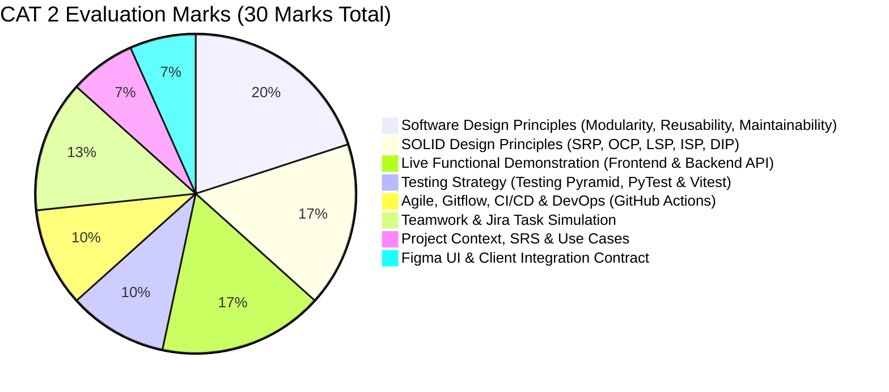

# SWE3020B CAT 2 Presentation Deck & Speaker Defense Script

**System:** Sacco Digital Savings Tracker  
**Evaluation:** CAT 2 System Defense (30 Marks)  
**Evaluator:** Prof. Eunice Mwangi  
**Engineering Team:**
* **Mercy Tryphen (Lead)** – System Architecture & Backend Infrastructure (Student ID: 674748)
* **Jescah Otwoma** – API Contracts & Payment Gateways (Student ID: 673748)
* **Nyeliep Nial** – Frontend UI/UX Design & Client Architecture (Student ID: 673176)
* **Tayak Ruai** – Software Quality Assurance & Automated Test Engineering (Student ID: 671649)
* **Roy Githaiga** – Client Integration & Agile Scrum Facilitator  

**PowerPoint File:** [`docs/CAT2_PRESENTATION_SACCO_TRACKER.pptx`](file:///c:/Users/user/Documents/Quality%20assurance/SWE-3020-GROUP_PROJECT/docs/CAT2_PRESENTATION_SACCO_TRACKER.pptx)

---

## 1. 30-Mark Rubric Mapping & Ownership Matrix

| Slide # | Slide Title | Rubric Category | Marks | Speaker / Lead | Code & Deliverable Proof to Point To |
| :---: | :--- | :--- | :---: | :---: | :--- |
| **1** | Title & Collaborative Team Roster | Teamwork & Governance | **4** | **Mercy** | All 5 members apportioned across specialized engineering tracks. |
| **2** | Project Context & Problem Analysis | Project Context & Use Cases | **2** | **Roy** | Real-world Chama failures: Trust deficit, phantom borrowing, default cascades. |
| **3** | Kruchten 4+1 Layered Decomposition | Software Design Principles | **6** | **Mercy** | 3-tier separation: React UI $\leftrightarrow$ FastAPI Boundary $\leftrightarrow$ Domain Core. |
| **4** | Modularity, Reusability & Maintainability | Software Design Principles | **6** | **Mercy** | Generic `BaseRepository[T]`, Parnas Information Hiding, zero circular dependencies. |
| **5** | SOLID Principles: SRP & OCP | SOLID Design Principles | **5** | **Jescah** | `LoanCalculationService` (pure math) vs `LedgerRepo`; Pluggable `IPaymentGateway`. |
| **6** | SOLID Principles: LSP, ISP & DIP | SOLID Design Principles | **5** | **Jescah** | Gateway interchangeable substitution (LSP); Lean interfaces (ISP); FastAPI DI (DIP). |
| **7** | Testing Strategy & The Testing Pyramid | Testing Strategy | **3** | **Tayak** | ISO 29119 pyramid: 16 PyTests (0.75s) + 28 Vitest tests (2.23s), ledger balance invariants. |
| **8** | Agile, Version Control, CI/CD & DevOps | Git, CI/CD & DevOps | **3** | **Tayak** | GitHub Actions green badge (`backend-ci.yml`), path filtering, Docker Compose. |
| **9** | Agile Project Management & Jira Backlog | Teamwork & Project Management| **4** | **Roy** | 6 Epics, 17 User Stories with Gherkin BDD Acceptance Criteria (`SACCO-101` to `117`). |
| **10** | Live System Walkthrough Transition | System Live Demonstration | **5** | **All Team** | Live Member Portal (deposit, 3x loan) + Admin Portal (reconciliation, approval). |

---

## 2. Slide-by-Slide Defense Script & Speaker Talking Points

### Slide 1: Title & Collaborative Team Roster
* **Speaker:** Mercy Tryphen (Lead Architect)
* **Timing:** 0:00 – 1:00 (1 min)
* **Script:**
  > *"Good morning Professor Eunice. Today our team presents the **Sacco Digital Savings Tracker**, an automated, double-entry financial core engineered to replace error-prone manual chama spreadsheets. To achieve institutional software quality, our team divided responsibilities across five distinct engineering tracks:
  > - I served as Lead System Architect and Backend Infrastructure Engineer.
  > - Jescah Otwoma engineered our API Contracts and Pluggable Payment Gateways.
  > - Nyeliep Nial designed our Frontend UI/UX, Design System, and React Client Architecture.
  > - Tayak Ruai directed Software Quality Assurance, Invariant Testing, and CI/CD Pipelines.
  > - Roy Githaiga facilitated our Agile Scrum sprints and Client Integration.
  > Our presentation today walks directly through the 30-mark CAT 2 rubric to demonstrate our architectural rigor, SOLID compliance, automated testing, and live functional system."*

---

### Slide 2: Project Context & Problem Domain Analysis
* **Speaker:** Roy Githaiga (Client Integration & Agile Facilitator)
* **Timing:** 1:00 – 2:00 (1 min)
* **Script:**
  > *"Manual SACCOs and chamas in Kenya suffer from three fatal structural vulnerabilities:
  > 1. **The Trust Deficit:** Savers cannot independently verify whether their physical cash was banked or held as paper vouchers.
  > 2. **Phantom Eligibility:** Treasurers calculate borrowing limits by hand, resulting in loans that exceed group cash reserves.
  > 3. **Guarantor Default Cascades:** Informal paper pledges lack immutable records to legally attach shares when a borrower defaults.
  >
  > We solved this by codifying non-negotiable mathematical invariants into the core domain:
  > - **Double-Entry Accounting:** Every deposit and repayment creates debit and credit entries where $\sum \text{Debit} - \sum \text{Credit} = 0$.
  > - **The $3\times$ Savings Ceiling:** A member's maximum borrowing limit is strictly bounded by $3 \times \text{Total Shares}$.
  > - **Mandatory Guarantor Collateral:** Loans exceeding personal savings require two active guarantors whose combined collateral covers the risk."*

---

### Slide 3: System Architecture & 3-Tier Layered Decomposition
* **Speaker:** Mercy Tryphen (Lead Architect)
* **Timing:** 2:00 – 3:30 (1.5 mins)
* **Script:**
  > *"To avoid the notorious 'Smart UI / Fat Controller' anti-pattern where SQL and calculations leak into web routes, our system follows Kruchten's 4+1 views across a strict 3-tier layered architecture:
  > 1. **Presentation Tier (React 19 + Vite):** A responsive client providing dual, role-isolated portals for Members and Treasurers, verified by client-side Vitest tests.
  > 2. **API & Boundary Tier (FastAPI + Pydantic V2):** The network perimeter. All incoming requests pass through Pydantic schemas enforcing regex, positive bounds, and HTTP 422 defensive gates.
  > 3. **Domain Core & Persistence Tier (SQLAlchemy ORM + SQLite/PostgreSQL):** Pure Python business services isolated from SQL specifics, backed by an append-only double-entry ledger.
  > Each tier communicates strictly through contracts, ensuring loose coupling and high cohesion."*

---

### Slide 4: Software Design Principles (6 Marks)
* **Speaker:** Mercy Tryphen
* **Timing:** 3:30 – 5:00 (1.5 mins)
* **Script:**
  > *"For the 6 marks on Software Design Principles, we demonstrate:
  > - **Modularity:** Our Controller-Service-Repository pattern. `app/api` handles HTTP serialization; `app/services` handles business logic; and `app/repositories` handles database operations. Neither controller nor service executes raw SQL.
  > - **Reusability:** We created a generic `BaseRepository[T]` leveraging Python generics. It standardizes basic CRUD operations—filtering, pagination, entity lookups—reused across Member, Loan, and Ledger tables without duplicating SQL code.
  > - **Maintainability & Information Hiding:** In accordance with David Parnas' principles, our domain calculation services (`LoanCalculationService`) are pure functions with zero database dependencies. If our SACCO changes its amortization formula, zero database tables or API controllers need to be modified."*

---

### Slide 5 & 6: SOLID Design Principles (5 Marks)
* **Speaker:** Jescah Otwoma (API Contracts & Payment Gateways)
* **Timing:** 5:00 – 7:00 (2 mins)
* **Script:**
  > *"For the 5 marks on SOLID principles:
  > - **S (Single Responsibility):** `LoanCalculationService` has one single reason to change: amendments to financial bylaws. `LedgerRepository` has one single reason to change: persistence schema changes. Neither handles HTTP or JSON.
  > - **O (Open/Closed):** We implemented the **Strategy Pattern** for payments via `IPaymentGateway`. `SavingsService` is closed for modification, but open for extension. If we add Airtel Money tomorrow, we simply implement `IPaymentGateway` without editing our savings core.
  > - **L (Liskov Substitution):** Both `MpesaDarajaGateway` and `BankTransferGateway` implement `IPaymentGateway`. Any service accepting `IPaymentGateway` can swap between Safaricom STK Push and Bank EFT interchangeably without type-checking or unexpected exceptions.
  > - **I (Interface Segregation):** Instead of a fat monolithic interface, we created discrete, cohesive contracts: `ILoanCalculator`, `IPaymentGateway`, and `IBaseRepository`.
  > - **D (Dependency Inversion):** High-level services depend on abstract interfaces injected through FastAPI's `Depends()` dependency injection container, allowing us to swap databases or mock payment gateways in automated tests effortlessly."*

---

### Slide 7: Testing Strategy & The Testing Pyramid (3 Marks)
* **Speaker:** Tayak Ruai (SQA & Test Engineer)
* **Timing:** 7:00 – 8:30 (1.5 mins)
* **Script:**
  > *"For the 3 marks on Testing, our project adheres to the classical ISO/IEC/IEEE 29119 Testing Pyramid:
  > - **Unit Tests:** 15 deterministic backend tests in `tests/unit/` verifying borrowing multipliers, zero-share boundaries, reducing-balance amortization schedules, guarantor shortfall math, and delinquency grace periods. On the frontend, Nyeliep wrote 16 Vitest unit tests in `loan.test.js` and `format.test.js`.
  > - **Integration Tests:** `test_api_endpoints.py` tests a complete member lifecycle: Registration $\to$ JWT auth $\to$ KES 10,000 M-Pesa deposit $\to$ limit unlock $\to$ loan application with 2 guarantors $\to$ repayment.
  > - **Invariant Verification:** `test_ledger_invariants.py` mathematically proves that every transaction balances debits and credits ($\sum D - \sum C = 0$).
  > - **Performance:** All 16 backend tests execute in **0.75 seconds**, and all 28 frontend tests execute in **2.23 seconds**, achieving a **100% Pass Rate**."*

---

### Slide 8: Agile, Version Control, CI/CD & DevOps (3 Marks)
* **Speaker:** Tayak Ruai / Roy Githaiga
* **Timing:** 8:30 – 10:00 (1.5 mins)
* **Script:**
  > *"For the 3 marks on Agile, Version Control, CI/CD, and DevOps:
  > - **Version Control:** We enforced Gitflow branching (`main`, `develop`, feature branches), executed formal Pull Requests (PR #1 through #5), and resolved complex Modify/Delete merge conflicts cleanly from the command line.
  > - **CI/CD Pipeline:** Our GitHub Actions workflow (`backend-ci.yml`) automatically checks out code, provisions Python 3.11 with pip caching, lints with `flake8`, and executes all PyTests. We implemented smart path filtering so backend CI only triggers when backend code changes. Our latest run is **100% Green ✅**.
  > - **DevOps & Environment Parity:** We packaged the application in a multi-stage `Dockerfile` and `docker-compose.yml` to guarantee zero environment drift between local machines and production."*

---

### Slide 9: Agile Project Management & Jira Backlog (4 Marks)
* **Speaker:** Roy Githaiga (Scrum Facilitator)
* **Timing:** 10:00 – 11:00 (1 min)
* **Script:**
  > *"For the 4 marks on Teamwork and Agile Project Management:
  > We organized our project across 6 Epics and 17 User Stories (SACCO-101 to SACCO-117) documented in `docs/JIRA_SIMULATION_AND_TASK_REGISTER.md`. Every user story was written with formal **Gherkin Acceptance Criteria (`Given / When / Then`)**. We operated in two 1-week sprints: Sprint 1 established system architecture and 3NF database models; Sprint 2 delivered the core financial logic, M-Pesa STK push, and client integration."*

---

### Slide 10: Live Functional Demonstration Transition (5 Marks)
* **Speaker:** Mercy Tryphen & Team
* **Timing:** 11:00 – 15:00 (4 mins)
* **Demonstration Steps:**
  1. **Member Portal Login ([`http://localhost:5173`](http://localhost:5173)):**
     * Log in as Mercy (`+254712345678` / `MemberPass123!`).
     * Show personal dashboard: Savings balance, $3\times$ borrowing limit, and personal statements.
  2. **Execute M-Pesa Deposit:**
     * Navigate to `/deposits`, submit KES 5,000 deposit.
     * Show real-time feedback with transaction reference (`DAR_XXXXXX`).
  3. **Loan Application with Guarantor Collateral:**
     * Navigate to `/loans/apply`, demonstrate loan calculator meter updating borrowing ceiling in real time.
     * Select 2 guarantors and submit application.
  4. **Switch to Admin / Treasurer Portal:**
     * Log in as Prof. Eunice (`+254700111222` / `AdminSecure123!`).
     * View group-wide cash reconciliation, member directory, and pending loan approvals.
     * Click **Approve** on Mercy's pending loan application.
  5. **Inspect Backend Swagger API & Audit Trail ([`http://127.0.0.1:8000/docs`](http://127.0.0.1:8000/docs)):**
     * Open `/api/v1/savings/ledger/2`: Show balanced double-entry rows.
     * Open `/api/v1/audit/logs`: Show immutable audit log recording the approval action.
