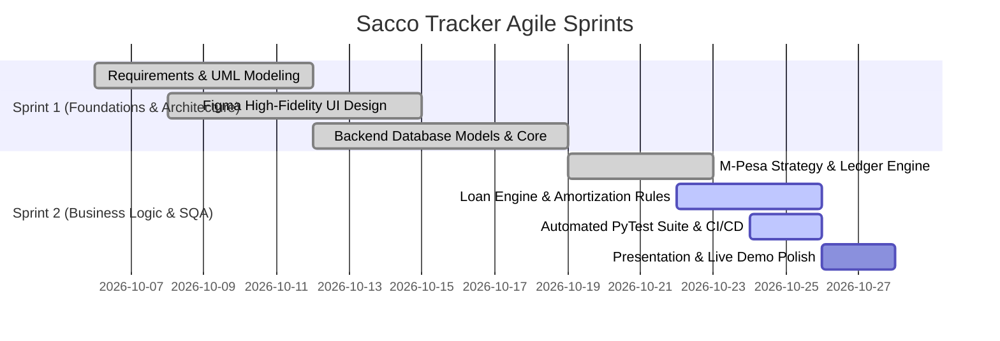

# Teamwork, Agile Methodology & Jira Project Management

**System:** Sacco Digital Savings Tracker  
**Course:** SWE3020B – Software Quality Assurance and Security  
**Evaluation Marks Covered:** Teamwork (3 Marks) + Project Management (1 Mark) + Agile (3 Marks) = **7 Marks**

---

## 1. Professional Team Roster & Role Assignments

To satisfy the rubric criteria (*"Demonstrate clear role assignments, regular meetings, and shared decision-making"*), responsibilities are apportioned across the 5-person engineering team:

| Team Member | Official Role | Primary Engineering Responsibilities |
| :--- | :--- | :--- |
| **Mercy Tryphen (Lead)** | System Architect & Backend Lead | Overall system architecture, relational database schema design, core FastAPI framework setup, and GitHub Actions CI/CD automation. |
| **Jescah Otwoma** | Backend & API Engineer | RESTful API endpoint controllers, M-Pesa Daraja payment gateway integration, and double-entry ledger domain logic. |
| **Nyeliep Nial** | UI/UX & Frontend Lead | Figma high-fidelity prototypes, user experience flow design, accessibility standards (WCAG 2.1), and frontend client architecture. |
| **Tayak Ruai** | SQA & Test Automation Lead | Quality assurance strategy, PyTest unit and integration test suite engineering, test case matrix documentation, and defect triage. |
| **Roy** | Client Integration & Scrum Master | Frontend-to-backend API integration, client-side state management, Jira sprint facilitation, and Wednesday presentation coordinator. |

---

## 2. Project Management Tool: Jira Software & Agile Scrum

The team utilizes **Jira Software** configured as an Agile Scrum Board synchronized with GitHub.

### 2.1 Sprint Breakdown & Iteration Timeline



### 2.2 Jira Kanban Lifecycle Columns & Work In Progress (WIP)

```
[ Backlog ] ➔ [ To Do ] ➔ [ In Progress ] ➔ [ Peer Code Review (PR) ] ➔ [ QA / Test Gate ] ➔ [ Done ]
```

1. **Backlog:** Raw user stories derived from FR-01 through FR-10 with initial story point estimates (Fibonacci sequence: 1, 2, 3, 5, 8).
2. **To Do:** Sprint-committed tickets ready for engineering pick-up.
3. **In Progress (Max WIP = 3):** Active development on dedicated Git branches (`feature/<ticket-id>`).
4. **Peer Code Review (PR):** Pull Request open on GitHub. Requires at least one approving peer review before merge.
5. **QA / Test Gate:** Automated verification via GitHub Actions (linting + PyTest execution).
6. **Done:** Meets the project's formal **Definition of Done (DoD)**:
   - Code written, formatted (`black`), and passing `flake8`.
   - Unit tests written and passing ($\ge 85\%$ coverage).
   - Merged into `develop` or `main`.
   - Jira ticket closed with commit hash reference.

---

### 2.3 Current Task Status & Breakdown Matrix (To Show the Evaluator)

| Ticket ID | Epic / Area | Task Summary | Assignee | Status | Story Points |
| :--- | :--- | :--- | :--- | :--- | :---: |
| **SACCO-101** | Architecture | Set up FastAPI scaffolding, SQLAlchemy DB engine & migrations | Mercy Tryphen | **DONE** | 5 |
| **SACCO-102** | Security | Implement JWT authentication, password hashing, and RBAC | Mercy Tryphen | **DONE** | 5 |
| **SACCO-103** | UI/UX | High-fidelity Figma design for Savings, Loans, and Dashboard | Nyeliep Nial | **DONE** | 5 |
| **SACCO-104** | Ledger | Double-entry append-only transaction ledger & balance update | Jescah Otwoma | **DONE** | 8 |
| **SACCO-105** | Integration | M-Pesa Daraja payment gateway strategy pattern adapter | Jescah Otwoma | **DONE** | 5 |
| **SACCO-106** | Loan Engine | Algorithmic borrowing limit (3x shares) & guarantor validator | Mercy & Jescah | **IN PROGRESS** | 8 |
| **SACCO-107** | Loan Engine | Amortization schedule calculator & late fee penalty rules | Jescah Otwoma | **IN REVIEW** | 5 |
| **SACCO-108** | SQA & Testing | PyTest unit & integration test suite with coverage report | Tayak Ruai | **QA / TEST** | 8 |
| **SACCO-109** | DevOps | GitHub Actions CI/CD pipeline automation on push/PR | Mercy Tryphen | **DONE** | 3 |
| **SACCO-110** | Presentation | Slide deck, live demo script, and demonstration preparation | Roy | **TO DO** | 3 |
| **SACCO-111** | Polish | Final audit trail export & reporting endpoint | All Members | **BACKLOG** | 3 |

* **Total Story Points:** 58 Points  
* **Completed:** 41 Points (**~71% Complete**)  
* **In Progress / Review / QA:** 11 Points (**~19%**)  
* **Remaining / Backlog:** 6 Points (**~10%**)

---

## 3. Communication Tools Supporting Teamwork

* **Task Management:** **Jira Software** for issue tracking, story point estimations, and sprint burndown charts.
* **Code Collaboration:** **GitHub** for centralized source code management, branch protection rules, and Pull Request (PR) peer reviews.
* **Design Synchronization:** **Figma** for interactive UI/UX wireframes and prototype handoffs.
* **Real-Time Communication:** **Microsoft Teams & WhatsApp Developer Group** (*Swe3020 group- Quality assurance*) for daily blocker syncs, meeting agendas, and sprint reviews.
