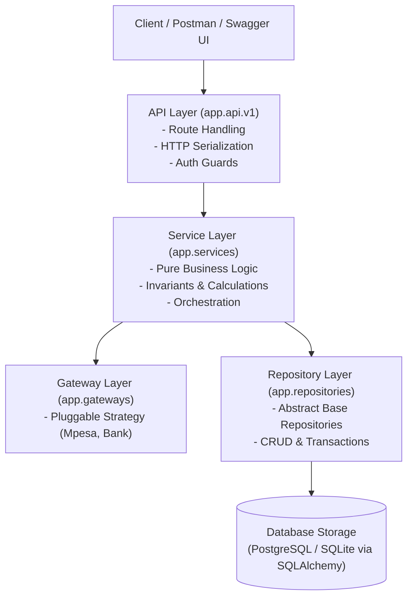

# Software Design Principles & SOLID Compliance

**System:** Sacco Digital Savings Tracker  
**Language & Framework:** Python 3.11+ / FastAPI  
**Evaluation Marks Covered:** Software Design Principles (6 Marks) + SOLID Principles (5 Marks) = **11 Marks**

---

## 1. Software Design Principles (Modularity, Reusability, Maintainability)

The system is designed following the **Controller-Service-Repository Pattern** (Clean Layered Architecture):



### 1.1 Modularity
* **Separation of Concerns:** Business logic (interest calculations, borrowing threshold rules) is completely decoupled from HTTP transport (FastAPI routing) and persistent database storage (SQLAlchemy).
* **Package Structure:**
  * `app/core/`: Application settings, security, cryptography, and database engine lifecycle.
  * `app/schemas/`: Pydantic boundary contracts enforcing strict type-checking and runtime data sanitization.
  * `app/models/`: Declarative relational database entities.
  * `app/interfaces/`: Abstract Base Classes (`abc.ABC`) declaring formal behavioral contracts.
  * `app/repositories/`: Encapsulated database operations.
  * `app/services/`: Isolated business logic engines.
  * `app/gateways/`: External third-party adapters.

### 1.2 Reusability
* **Generic Base Repository (`IBaseRepository[ModelType]`):** Standardizes common CRUD queries (`get_by_id`, `list_all`, `create`, `delete`) so that repositories reuse battle-tested data access routines without boilerplate duplication.
* **Reusable Pydantic Schemas:** Shared audit and monetary validation models reused across savings, loans, and ledger balance queries.

### 1.3 Maintainability
* Zero database coupling inside controllers: If the persistence mechanism is migrated from SQLite to PostgreSQL or CockroachDB, zero lines of business logic inside `app/services/loan_service.py` change.
* Pure domain methods can be unit-tested in isolation without starting a live web server or external network dependencies.

---

## 2. SOLID Principles Detailed Implementation

### 2.1 Single Responsibility Principle (SRP)
> *"A class or module should have one, and only one, reason to change."*

* **Implementation:**
  * `LoanCalculationService`: Dedicated exclusively to mathematical determinations (credit limits, amortizations, late delinquency penalties). It never touches the database directly or issues HTTP requests.
  * `LedgerRepository`: Exclusively responsible for executing atomic, append-only database operations and enforcing balance immutability.
  * `AuthService`: Exclusively handles credential verification, password hashing, and JWT claims encoding.
  * **Benefit:** A modification to loan penalty percentage logic does not touch ledger recording or user authentication code.

---

### 2.2 Open/Closed Principle (OCP)
> *"Software entities should be open for extension, but closed for modification."*

* **Implementation:**
  * We declare an abstract strategy interface `IPaymentGateway` in `app/interfaces/payment.py`:
    ```python
    from abc import ABC, abstractmethod

    class IPaymentGateway(ABC):
        @abstractmethod
        async def initiate_deposit(self, phone_number: str, amount: float, reference: str) -> PaymentResult:
            pass
    ```
  * We provide a concrete implementation `MpesaDarajaGateway` in `app/gateways/mpesa_gateway.py`.
  * If the SACCO subsequently introduces `BankTransferGateway` or `AirtelMoneyGateway`, new gateway classes are implemented *without modifying a single line of code* inside `SavingsLedgerService`.

---

### 2.3 Liskov Substitution Principle (LSP)
> *"Objects of a superclass should be replaceable with objects of its subclasses without breaking application correctness."*

* **Implementation:**
  * Any class implementing `IPaymentGateway` conforms strictly to the expected parameter types and return type `PaymentResult`.
  * In unit and integration test fixtures, a `MockPaymentGateway` inherits from `IPaymentGateway` and can be substituted transparently into `SavingsLedgerService` without altering caller behavior:
    ```python
    # Both MpesaDarajaGateway and MockPaymentGateway can be swapped seamlessly
    savings_service = SavingsLedgerService(gateway=MockPaymentGateway(), repo=ledger_repo)
    ```

---

### 2.4 Interface Segregation Principle (ISP)
> *"Clients should not be forced to depend upon interfaces that they do not use."*

* **Implementation:**
  * Rather than creating a giant `IBigSaccoService` interface containing 30 methods, interfaces are segregated into lean, focused contracts:
    * `IPaymentGateway`: Strictly payment processing operations (`initiate_deposit`, `query_transaction`).
    * `ILoanCalculator`: Strictly mathematical financial calculations (`compute_borrowing_limit`, `calculate_penalty`).
    * `IAuditable`: Defines entity change-tracking metadata.
  * Consumers only import and depend upon the exact interface slice they require.

---

### 2.5 Dependency Inversion Principle (DIP)
> *"High-level modules should not depend on low-level modules; both should depend on abstractions."*

* **Implementation:**
  * High-level service `SavingsLedgerService` does not instantiate low-level concrete classes like `MpesaDarajaGateway()` or direct database sessions.
  * Instead, it receives abstractions via its constructor:
    ```python
    class SavingsLedgerService:
        def __init__(self, payment_gateway: IPaymentGateway, ledger_repo: ILedgerRepository):
            self.gateway = payment_gateway
            self.ledger_repo = ledger_repo
    ```
  * In FastAPI, dependencies are injected declaratively using `Depends()`:
    ```python
    @router.post("/deposit")
    async def deposit(
        req: DepositRequest,
        service: SavingsLedgerService = Depends(get_savings_service)
    ):
        return await service.process_deposit(req)
    ```
