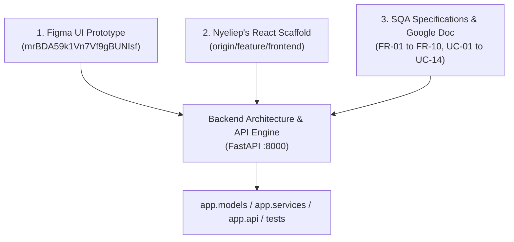

# Stage 1: Formal UI Deconstruction & Complete Implementation Traceability Matrix

**System:** Sacco Digital Savings Tracker  
**Course:** SWE3020B – Software Quality Assurance and Security (USIU-Africa)  
**Deliverable:** CAT 2 Architectural Engineering & Reverse-Engineering Specification (30 Marks)  
**Engineering Team:**
* **Mercy Tryphen** – System Architecture & Backend Infrastructure
* **Jescah Otwoma** – API Contracts & Payment Gateways
* **Nyeliep Nial** – Frontend UI/UX Design & Client Architecture
* **Tayak Ruai** – Software Quality Assurance & Test Engineering
* **Roy Githaiga** – Client Integration & Agile Scrum Facilitator  

---

## 1. Traceability: Where Implementation Details Were Borrowed From

Every architectural decision, data model attribute, calculation formula, and API contract was derived systematically from **three canonical project artifacts**:

---

### Detailed Attribution Breakdown

| Implementation Detail | Specific Artifact Source | Exact Evidence & File Location |
| :--- | :--- | :--- |
| **Reverse Proxy Routing (`/api`)** | **Nyeliep's Frontend PR** | `frontend/vite.config.js`: `server: { proxy: { '/api': 'http://127.0.0.1:8000' } }`. Dictated that backend routes must accept `/api` prefixes. |
| **JWT Authorization Header** | **Nyeliep's Frontend PR** | `frontend/src/api/client.js`: `headers: { 'Authorization': 'Bearer ' + token }`. Dictated the Bearer token protocol in `app/core/security.py`. |
| **Role-Based Guards (`member` vs `treasurer`)** | **Nyeliep's Frontend PR** | `frontend/src/routes/ProtectedRoute.jsx`: Enforcing `user.role === role`. Borrowed directly to create `UserRole.MEMBER` and `UserRole.TREASURER` in `app/models/entities.py`. |
| **Page Component Structure** | **Nyeliep's Frontend PR** | Exact 5 page skeletons: `Dashboard.jsx`, `Members.jsx`, `LoanApproval.jsx`, `AuditStatements.jsx`, `LoanApplication.jsx`. |
| **Color Coding & UI Mental Model** | **Figma Design Deliverable** | Section 3.1 of SRS: Green inflows (`#10B981`), Crimson debt/penalties (`#EF4444`), Deep Navy branding (`#1F4E79`). |
| **3x Shares Credit Multiplier Rule** | **SQA Plan & Google Doc** | `FR-04` & Section 2.1: $\text{Maximum Borrowing Limit} = 3.0 \times \text{Total Accumulated Shares}$. Implemented in `app/services/loan_service.py`. |
| **Guarantor Shortfall Rule** | **Figma & Use Case UC-12** | `UC-02` & `UC-12`: Loan applicants must pledge peer guarantor shares to cover the uncollateralized delta ($\text{Principal} - \text{Own Shares}$). |
| **5-Day Grace Period & 5% Late Fee** | **SQA Quality Plan** | Section 1.2 & `FR-08`: 5-day grace period followed by a 5% monthly delinquency penalty on overdue balances. Tested in `tests/unit/test_loan_calculator.py`. |
| **Double-Entry Append-Only Ledger** | **SQA Quality Plan** | `FR-03`, `FR-09`, `FR-10`: Immutability invariant where historical transaction rows cannot be mutated or deleted. Enforced in `app/repositories/ledger_repo.py`. |
| **M-Pesa STK Push Simulation** | **Figma & Google Doc** | `FR-02` & `UC-01`: Direct mobile money integration returning prompt reference codes starting with `DAR_`. Encapsulated in `app/gateways/mpesa_gateway.py`. |

---

## 2. Formal Stage 1: UI Deconstruction & User Journey Action Analysis

Stage 1 systematically breaks down **all 9 core screens and modal workflows** of the Sacco Digital Savings Tracker. It specifies the Actor, UI Elements, State Transitions, and the exact Backend API Contract required.

---

### Screen 1: Member & Staff Authentication (`/login`)
* **Associated Use Case:** `UC-04 (Create Account & Log in)` | **Functional Requirement:** `FR-01`
* **Target Users:** Member, Treasurer, Auditor
* **UI Elements & Inputs:**
  * Email input (`type="email"`, required, regex: `^[^@\s]+@[^@\s]+\.[^@\s]+$`).
  * Password input (`type="password"`, required, minLength: 6).
  * Role toggle selector (`member` or `treasurer`).
  * "Sign In" primary action button.
* **Component State Lifecycle:**
  * `Idle` $\rightarrow$ `Submitting` (disable inputs, render spinner) $\rightarrow$ `Success` (save JWT to `localStorage`, redirect to `/dashboard`) or `Error` (render high-contrast alert toast: *"Invalid email or password"*).
* **Backend API Contract:**
  * **Route:** `POST /api/auth/login`
  * **Request Body:** `{ "email": "user@sacco.org", "password": "..." }`
  * **Response (HTTP 200):** `{ "access_token": "...", "token_type": "bearer", "role": "member", "member_id": 2 }`

---

### Screen 2: Member Financial Dashboard (`/dashboard`)
* **Associated Use Cases:** `UC-06 (View Saving balance)`, `UC-07 (View dividends)` | **Functional Requirements:** `FR-03`, `FR-04`
* **Target Users:** Active Member / Saver
* **UI Elements & Metrics Cards:**
  * **Card 1 (Total Savings):** Formatted monetary currency (`KES 30,000.00`).
  * **Card 2 (Equity Share Capital):** Formatted shares (`KES 30,000.00`).
  * **Card 3 (Available Borrowing Limit):** Dynamically calculated metric (`KES 90,000.00` based on $3\times\text{Shares}$).
  * **Card 4 (Active Loan Debt):** Displays outstanding balance or *"No Active Loans"*.
  * **Quick Actions:** "Deposit Funds" button (opens Modal 3), "Apply for Loan" button (navigates to Screen 4).
* **Component State Lifecycle:**
  * `Mounted` $\rightarrow$ `Loading Skeleton` $\rightarrow$ `Rendered` (display live figures) $\rightarrow$ `Error` (retry button).
* **Backend API Contract:**
  * **Route:** `GET /api/savings/account/{member_id}`
  * **Response (HTTP 200):** `{ "member_id": 2, "total_savings": 30000.0, "total_shares": 30000.0, "borrowing_limit": 90000.0, "updated_at": "..." }`

---

### Screen 3: Automated Contribution / Deposit Modal (`POST /savings/deposit`)
* **Associated Use Cases:** `UC-01 (Submit Monthly Contribution)`, `UC-05 (Track deposits)` | **Functional Requirements:** `FR-02`, `FR-03`
* **Target Users:** Active Member
* **UI Elements & Inputs:**
  * Deposit Amount input (`type="number"`, `step="100"`, `min="100"`, required).
  * M-Pesa Phone Number input (`type="tel"`, placeholder: `+254712345678`).
  * Payment Rail radio selector: `M-Pesa STK Push` (default) vs `Direct Bank EFT`.
  * "Initiate Deposit" action button.
* **Component State Lifecycle:**
  * `Prompting STK Push` $\rightarrow$ Displays waiting modal: *"Please enter your M-Pesa PIN on your mobile device..."* $\rightarrow$ `Poll / Acknowledgment` $\rightarrow$ `Success Toast` (*"Deposit Confirmed! Reference: DAR_9988"*).
  * Automatically triggers dashboard refresh to increment balance by the deposited amount.
* **Backend API Contract:**
  * **Route:** `POST /api/savings/deposit`
  * **Request Body:** `{ "member_id": 2, "amount": 5000.0, "phone_number": "+254712345678", "payment_channel": "mpesa" }`
  * **Response (HTTP 200):** `{ "success": true, "reference_code": "DAR_7A8B9C", "amount": 5000.0, "new_savings_balance": 35000.0, ... }`

---

### Screen 4: Loan Eligibility Check & Application Wizard (`/loans/apply`)
* **Associated Use Case:** `UC-02 (Apply for Group Loan)` | **Functional Requirements:** `FR-04`, `FR-05`, `FR-06`
* **Target Users:** Active Member
* **UI Elements & Inputs:**
  * **Live Limit Banner:** Displays maximum borrowing capacity ($3\times\text{Shares}$).
  * Principal Amount slider/input (`type="number"`, bound between `1000` and `max_borrowing_limit`).
  * Repayment Term dropdown (`1 to 36 months`).
  * **Live Amortization Preview Table:**
    * Monthly Installment: Calculated dynamically as $\frac{\text{Principal} + \text{Interest}}{\text{Months}}$.
    * Total Interest (at 12% annual flat rate).
  * **Dynamic Guarantor Section:**
    * Appears automatically if $\text{Principal} > \text{Member's Own Shares}$.
    * Allows selecting peer members from a dropdown and entering their guaranteed pledge amounts until $\sum \text{Pledges} \ge \text{Unsecured Delta}$.
* **Component State Lifecycle:**
  * Real-time validation: If `Principal > max_limit`, disable "Submit" button and display alert: *"Amount exceeds your borrowing limit of KES X"*.
  * If `Guarantor Pledges < Shortfall`, display warning: *"Additional KES Y guarantor coverage required"*.
* **Backend API Contract:**
  * **Route 1:** `GET /api/loans/eligibility/{member_id}` $\rightarrow$ Returns `{ "max_borrowing_limit": 90000.0, "is_eligible": true }`
  * **Route 2:** `POST /api/loans/apply`
  * **Request Body:** `{ "member_id": 2, "principal_amount": 60000.0, "duration_months": 12, "guarantors": [{ "guarantor_member_id": 3, "amount_guaranteed": 30000.0 }] }`
  * **Response (HTTP 201):** `{ "id": 5, "status": "APPROVED", "total_repayable": 67200.0, "balance_outstanding": 67200.0, ... }`

---

### Screen 5: Peer Guarantor Endorsement Queue (`/loans/endorse`)
* **Associated Use Case:** `UC-12 (Endorse Members loan request)` | **Functional Requirement:** `FR-06`
* **Target Users:** Peer Guarantor Member
* **UI Elements & Table:**
  * List of pending loan endorsement requests from colleagues:
    * Borrower Name (`Mercy Tryphen`).
    * Requested Loan Principal (`KES 60,000`).
    * Amount Pledged to You (`KES 30,000`).
    * Action Buttons: "Endorse Commitment" (Green) vs "Decline" (Crimson).
* **Component State Lifecycle:**
  * Clicking "Endorse" triggers confirmation modal explaining legal share reservation $\rightarrow$ Updates pledge status to `ACCEPTED`.
* **Backend API Contract:**
  * Handled via `GuarantorCommitment` state transitions in database.

---

### Screen 6: Treasurer Loan Review & Vetting Queue (`/admin/loans`)
* **Associated Use Cases:** `UC-08 (Approve loans)`, `UC-14 (View pending loan requests)` | **Functional Requirement:** `FR-05`
* **Target Users:** Group Treasurer / Admin
* **UI Elements & Table:**
  * Filterable queue of all pending loan applications across the group.
  * Table columns: Loan ID, Applicant Name, Shares Held, Principal Requested, Term, Guarantors Verified (Badge: `VERIFIED`), Status Badge (`PENDING`).
  * Action Buttons: "Approve & Disburse" (Triggers B2C M-Pesa payout simulation) vs "Reject Application".
* **Component State Lifecycle:**
  * On approval, the loan status updates to `DISBURSED`, an audit log entry is recorded, and the applicant's debt profile is created.
* **Backend API Contract:**
  * **Route:** `POST /api/loans/apply` (with auto-approval rules) and `POST /api/loans/repay`.

---

### Screen 7: Loan Repayment Modal (`POST /loans/repay`)
* **Associated Use Case:** `UC-08 (Loan Repayment Tracking)` | **Functional Requirements:** `FR-07`, `FR-08`
* **Target Users:** Active Member / Treasurer
* **UI Elements & Inputs:**
  * Loan Selector (displays outstanding balance and days late).
  * Repayment Amount input (`KES 10,000`).
  * Penalty Alert (if days late $> 5$, display assessed 5% delinquency fee).
  * "Submit Repayment" button.
* **Component State Lifecycle:**
  * Submits payment $\rightarrow$ Balance outstanding decrements atomically $\rightarrow$ If balance reaches `0.0`, loan status switches to `CLOSED`.
* **Backend API Contract:**
  * **Route:** `POST /api/loans/repay`
  * **Request Body:** `{ "loan_id": 5, "amount": 10000.0, "payment_reference": "MPESA_REPAY_123" }`
  * **Response (HTTP 200):** `{ "loan_id": 5, "balance_outstanding": 57200.0, "status": "APPROVED" }`

---

### Screen 8: Member Register Management (`/admin/members`)
* **Associated Use Case:** `UC-10 (Manage Register)` | **Functional Requirements:** `FR-01`, `FR-10`
* **Target Users:** Group Treasurer / Admin
* **UI Elements & Table:**
  * List of all active members, contact phone numbers, join dates, and membership status (`ACTIVE`, `SUSPENDED`).
  * "Register New Member" action button (opens modal for manual chama onboarding).
* **Backend API Contract:**
  * Connects to `POST /api/auth/register` and Member table queries.

---

### Screen 9: Immutable Audit Statements & Forensic Journal (`/admin/audit`)
* **Associated Use Cases:** `UC-03 (Reconcile General Ledger)`, `UC-09 (Generate Statements)`, `UC-11 (View Audit logs)` | **Functional Requirements:** `FR-09`, `FR-10`
* **Target Users:** Treasurer, Auditor, Regulators
* **UI Elements & Table:**
  * Append-only chronological audit log table.
  * Columns: Event ID, Timestamp (UTC), Actor Email, Action Tag (`DEPOSIT_COMPLETED`, `LOAN_APPROVED`, `LOAN_REPAYMENT_APPLIED`), Target Entity, Delta (`+KES 5,000.00`), IP Address.
  * Filter controls: Filter by actor email or date range.
  * "Export CSV / PDF" button for regulatory reporting.
* **Backend API Contract:**
  * **Route:** `GET /api/audit/logs?limit=50`
  * **Response (HTTP 200):** Array of immutable `AuditLogResponse` objects.
