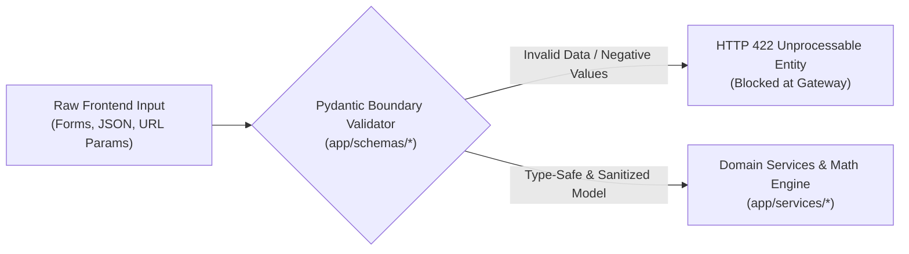
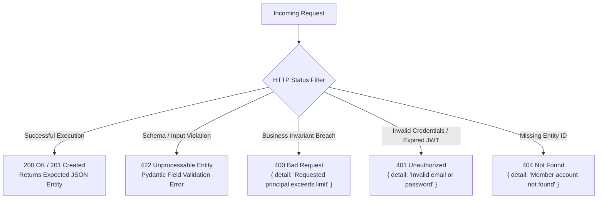

# Stage 2: Formal Boundary Schema Contracts & Pydantic Validation Specification

**System:** Sacco Digital Savings Tracker API  
**Course:** SWE3020B – Software Quality Assurance and Security (USIU-Africa)  
**Governing Standards:** ISO/IEC 25010:2023 (Security & Fault Tolerance), RFC 7807 (Problem Details for HTTP APIs)  
**Deliverable:** CAT 2 Backend Engineering Specification (Stage 2)  
**Lead System Architect & Backend Lead:** Mercy Tryphen (674748)  

---

## 1. What is Stage 2? (The Defensive Contract Barrier)

In modern software engineering, **Stage 2 establishes the defensive perimeter of your application**. It transforms the raw UI inputs and user actions identified in Stage 1 into strict, type-safe data contracts before any business logic executes or any database query runs.



### Why Stage 2 Protects Quality & Security (Rubric Alignment)
1. **Defensive Programming:** Prevents malicious or erroneous inputs (e.g., negative deposit amounts, zero-month loans, malformed phone numbers) from reaching financial ledgers.
2. **Deterministic Serialization:** Guarantees that the frontend receives predictable, typed JSON responses across all client devices.
3. **Automated OpenAPI / Swagger Generation:** FastAPI uses these Pydantic schemas to auto-generate the interactive documentation at `http://127.0.0.1:8000/docs`.

---

## 2. Exhaustive Boundary Contract Specifications

Below is the complete mapping of every request and response schema in the system, detailing field types, boundary constraints, validation rules, and error handling.

---

### Contract Category 1: Identity & Access Management (`app/schemas/member.py`)

#### 1. `MemberRegisterRequest` (Payload for `POST /api/auth/register`)
* **Purpose:** Validates new member onboarding data.
* **Fields & Boundary Constraints:**
  * `email`: `str` — Must match strict email pattern: `^[^@\s]+@[^@\s]+\.[^@\s]+$`.
  * `full_name`: `str` — Minimum length: 2 characters, maximum: 150 characters.
  * `phone_number`: `str` — E.164 international regex: `^\+?[0-9]{10,15}$` (e.g. `+254712345678`).
  * `password`: `str` — Minimum length: 6 characters (enforces complexity).
  * `role`: `Optional[str]` — Defaults to `"member"`. Must be one of `["member", "treasurer", "admin"]`.
* **Validation Defense:** Rejects SQL injection characters, malformed email addresses, and blank names.

#### 2. `MemberLoginRequest` (Payload for `POST /api/auth/login`)
* **Purpose:** Validates credential submission for authentication.
* **Fields:** `email` (`str`), `password` (`str`).

#### 3. `TokenResponse` (Response from `POST /api/auth/login`)
* **Fields:**
  * `access_token`: `str` (Base64-HMAC-SHA256 signed token).
  * `token_type`: `str = "bearer"`.
  * `role`: `str` (`member` or `treasurer`).
  * `email`: `str`.
  * `member_id`: `int`.

#### 4. `MemberResponse` (Response Model for Member Profile)
* **Configuration:** `ConfigDict(from_attributes=True)` for seamless SQLAlchemy ORM serialization.
* **Fields:** `id` (`int`), `email` (`str`), `full_name` (`str`), `phone_number` (`str`), `role` (`str`), `created_at` (`datetime`).

---

### Contract Category 2: Transactional Core & Ledger (`app/schemas/savings.py`)

#### 5. `DepositRequest` (Payload for `POST /api/savings/deposit`)
* **Purpose:** Ingests member savings contributions.
* **Fields & Boundary Constraints:**
  * `member_id`: `int` — Foreign key of the contributing member.
  * `amount`: `float = Field(..., gt=0)` — **Strict Boundary:** Must be strictly greater than zero. Rejects `0.0`, `-100.0`, or `NaN`.
  * `phone_number`: `str = Field(..., pattern=r"^\+?[0-9]{10,15}$")` — Mobile money billing number.
  * `payment_channel`: `Optional[str] = "mpesa"` — Strategy selector (`"mpesa"` or `"bank"`).
* **Validation Defense:** Zero or negative monetary amounts are rejected at the HTTP boundary before database locking occurs.

#### 6. `DepositResponse` (Response from `POST /api/savings/deposit`)
* **Fields:**
  * `success`: `bool = True`.
  * `reference_code`: `str` (e.g. `DAR_7A8B9C0D1E`).
  * `amount`: `float` (exact deposited figure).
  * `new_savings_balance`: `float` (atomically incremented balance).
  * `new_total_shares`: `float` (equity shares credited).
  * `timestamp`: `datetime`.
  * `message`: `str`.

#### 7. `SavingsAccountSummary` (Response for `GET /api/savings/account/{id}`)
* **Configuration:** `ConfigDict(from_attributes=True)`.
* **Fields:**
  * `member_id`: `int`.
  * `total_savings`: `float` (liquid savings).
  * `total_shares`: `float` (collateral equity).
  * `borrowing_limit`: `float` (dynamically computed as $3.0 \times \text{total\_shares}$).
  * `updated_at`: `datetime`.

#### 8. `LedgerTransactionResponse` (Response for `GET /api/savings/ledger/{id}`)
* **Configuration:** `ConfigDict(from_attributes=True)`.
* **Fields:** `id` (`int`), `account_id` (`int`), `transaction_type` (`str`), `amount` (`float`), `balance_after` (`float`), `reference_code` (`str`), `description` (`Optional[str]`), `timestamp` (`datetime`).

---

### Contract Category 3: Credit Engine & Loan Origination (`app/schemas/loan.py`)

#### 9. `GuarantorCommitmentInput` (Nested Model within Loan Application)
* **Fields & Constraints:**
  * `guarantor_member_id`: `int` — Identity of peer guarantor.
  * `amount_guaranteed`: `float = Field(..., gt=0)` — Pledged coverage amount (strictly positive).

#### 10. `LoanApplicationRequest` (Payload for `POST /api/loans/apply`)
* **Purpose:** Submits a loan request for algorithmic qualification and guarantor binding.
* **Fields & Boundary Constraints:**
  * `member_id`: `int` — Borrower identity.
  * `principal_amount`: `float = Field(..., gt=0)` — Requested capital (must be positive).
  * `duration_months`: `int = Field(..., ge=1, le=36)` — Repayment period bounded between 1 and 36 months.
  * `guarantors`: `List[GuarantorCommitmentInput] = []` — Array of guarantor pledges.
* **Validation Defense:** Prevents requesting 0-month terms or negative loans. If $\text{Principal} > 3\times\text{Shares}$ or $\sum \text{Guarantors} < \text{Shortfall}$, business logic rejects the request with HTTP 400.

#### 11. `LoanEligibilityResponse` (Response for `GET /api/loans/eligibility/{id}`)
* **Fields:**
  * `member_id`: `int`.
  * `total_shares`: `float`.
  * `max_borrowing_limit`: `float` ($3\times\text{Shares}$).
  * `is_eligible`: `bool`.
  * `rejection_reason`: `Optional[str] = None`.

#### 12. `LoanRepaymentRequest` (Payload for `POST /api/loans/repay`)
* **Fields & Constraints:**
  * `loan_id`: `int`.
  * `amount`: `float = Field(..., gt=0)`.
  * `payment_reference`: `str` (e.g. `MPESA_REPAY_9988`).

#### 13. `LoanResponse` (Response Model for Loan Entities)
* **Configuration:** `ConfigDict(from_attributes=True)`.
* **Fields:** `id` (`int`), `member_id` (`int`), `principal_amount` (`float`), `interest_rate` (`float`), `duration_months` (`int`), `total_repayable` (`float`), `balance_outstanding` (`float`), `penalty_accumulated` (`float`), `status` (`str`), `created_at` (`datetime`), `due_date` (`datetime`).

---

### Contract Category 4: Forensic Audit Trail (`app/schemas/audit.py`)

#### 14. `AuditLogResponse` (Response for `GET /api/audit/logs`)
* **Configuration:** `ConfigDict(from_attributes=True)`.
* **Fields:** `id` (`int`), `actor_email` (`str`), `action` (`str`), `entity_name` (`str`), `entity_id` (`Optional[int]`), `delta` (`Optional[str]`), `ip_address` (`str`), `timestamp` (`datetime`).

---

## 3. Standardized HTTP Status Codes & Error Models (RFC 7807)

The API enforces uniform, standard HTTP response codes so the frontend client can handle errors deterministically:



### Standard Error JSON Format:
```json
{
  "detail": "Requested principal KES 50,000.00 exceeds allowable limit of KES 30,000.00"
}
```

---

## 4. Verification: How Stage 2 Schemas Are Tested in PyTest

Every schema constraint is backed by an automated boundary test in `tests/`:

1. **Negative Deposit Rejection (`tests/unit/test_ledger_invariants.py`):**
   * Submitting `amount = -500.0` fails Pydantic validation before database execution.
2. **Borrowing Limit Boundary (`tests/unit/test_loan_api_validation.py`):**
   * Submitting a loan application exceeding $3.0\times\text{Shares}$ returns HTTP 400 with exact discrepancy details.
3. **Guarantor Shortfall Boundary (`tests/unit/test_loan_api_validation.py`):**
   * Submitting guarantor coverage less than the unsecured loan delta returns HTTP 400.
4. **Delinquency Penalty Boundary (`tests/unit/test_loan_calculator.py`):**
   * Validating that late days $\le 5$ returns KES 0.0, while late days $= 6$ assesses the strict 5% fee.
