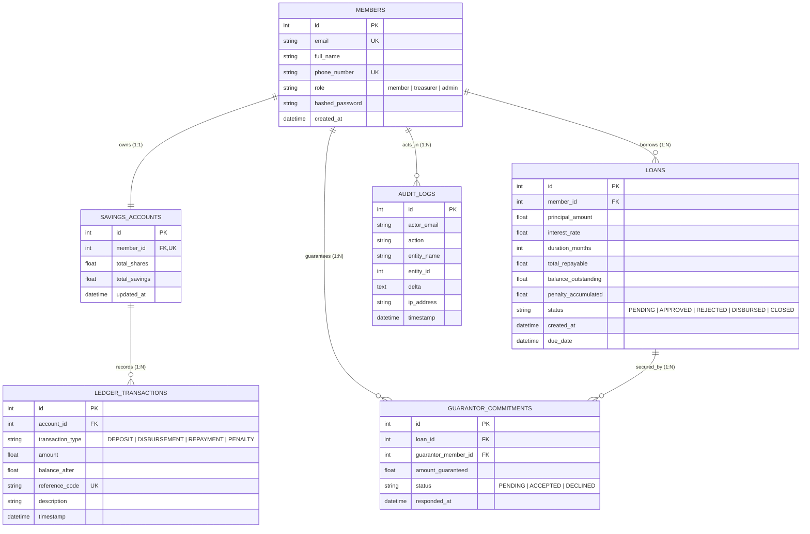

# Stage 3: Domain Entity & Invariant Modeling

**Project:** SACCO Digital Savings Tracker (SWE3020B Quality Assurance & Security)  
**Lead System Architect & Backend Infrastructure Engineer:** Mercy Tryphen (Student ID: 674748)  
**Governing Standard:** ISO/IEC 25010:2023, IEEE 730-2014, ACID Relational Integrity  
**Source Code Reference:** [`app/models/entities.py`](file:///c:/Users/user/Documents/Quality%20assurance/SWE-3020-GROUP_PROJECT/app/models/entities.py)

---

## 1. Executive Summary & Objective

In **Stage 1**, we deconstructed the 9 UI screens from Figma and the React frontend into user intent and data attributes. In **Stage 2**, we established defensive boundary schemas via Pydantic to validate all payloads at the network perimeter.

**Stage 3** translates those external representations into an internal, ACID-compliant **Domain Relational Model**. Because this is a financial system dealing with real money, member savings, and legally binding loan obligations, standard CRUD design is strictly prohibited. Stage 3 enforces:
1. **Third Normal Form (3NF)** database normalization to prevent data redundancy and update anomalies.
2. **Immutable Double-Entry Ledger Invariants** where balances are derived from an immutable stream of ledger transactions rather than arbitrary column overwrites.
3. **Domain Business Invariants** ($3\times$ shares loan limit, guarantor pledge coverage, and non-negative balance constraints).

---

## 2. Entity-Relationship Model (ERD)

The domain is modeled into six normalized entities in [`app/models/entities.py`](file:///c:/Users/user/Documents/Quality%20assurance/SWE-3020-GROUP_PROJECT/app/models/entities.py):



---

## 3. Third Normal Form (3NF) Normalization Proof

To meet academic evaluation standards under Software Design Principles, the database schema strictly satisfies **3NF**:

| Normal Form | Formal Condition | Implementation in SACCO Core |
| :--- | :--- | :--- |
| **First Normal Form (1NF)** | All attributes contain only atomic (indivisible) values; each record has a unique primary key; no repeating groups. | Every table has an auto-incrementing integer `id PK`. Attributes like phone numbers, emails, and financial amounts are scalar. |
| **Second Normal Form (2NF)** | Must satisfy 1NF, and all non-key attributes are fully functionally dependent on the entire primary key (no partial dependencies). | All tables use single-attribute primary keys (`id`), completely eliminating partial functional key dependencies. |
| **Third Normal Form (3NF)** | Must satisfy 2NF, and no non-key attribute is transitively dependent on another non-key attribute ($X \rightarrow Y \rightarrow Z$). | Member details (`full_name`, `email`) are **not** duplicated on `loans` or `savings_accounts`. They are referenced strictly via foreign key `member_id FK`. |

---

## 4. Mathematical Domain Invariants & Integrity Constraints

Financial systems cannot rely on application logic alone; invariants must be mathematically bounded and proven:

### Invariant 1: Double-Entry Ledger Invariance
An account balance $\text{Balance}_T$ at any given point in time $T$ must equal the sum of all historical transactions:

$$\text{Balance}_T = \sum_{t=1}^{T} \Delta \text{Transaction}_t$$

* **Append-Only Property:** `ledger_transactions` permits only `INSERT` statements. `UPDATE` and `DELETE` operations are strictly blocked by the repository layer.
* **Auditability:** `balance_after` is recorded at each transaction step to detect any race condition or unauthorized database tampering.

### Invariant 2: Sacco Lending Ratio ($3\times$ Multiplier Rule)
Under SACCO regulatory rules, a member cannot borrow more than three times their accumulated share capital:

$$\text{Principal Amount} \le 3 \times \text{Member Total Shares}$$

* If $\text{Principal} > 3 \times \text{Total Shares}$, the loan application is rejected immediately with a domain rule violation.

### Invariant 3: Guarantor Coverage Invariant
For any loan principal exceeding the member's own savings balance, the differential must be guaranteed by active SACCO members:

$$\text{Borrower Free Shares} + \sum_{g \in \text{Guarantors}} \text{Pledged Amount}_g \ge \text{Principal Amount}$$

* A guarantor cannot pledge more than their own free shares.
* A loan cannot transition from `PENDING` to `APPROVED` until all required guarantor commitments are in `ACCEPTED` status.

### Invariant 4: Non-Negative Balance Invariant
Under no circumstances may a savings account balance drop below zero:

$$\text{total\_savings} \ge 0.00 \quad \land \quad \text{balance\_outstanding} \ge 0.00$$

---

## 5. SQLAlchemy Implementation Details

The relational model is implemented in [`app/models/entities.py`](file:///c:/Users/user/Documents/Quality%20assurance/SWE-3020-GROUP_PROJECT/app/models/entities.py):

```python
# app/models/entities.py (Snippet)

class Member(Base):
    __tablename__ = "members"

    id = Column(Integer, primary_key=True, index=True)
    email = Column(String(120), unique=True, index=True, nullable=False)
    full_name = Column(String(150), nullable=False)
    phone_number = Column(String(20), unique=True, index=True, nullable=False)
    role = Column(String(20), default=UserRole.MEMBER.value, nullable=False)
    hashed_password = Column(String(255), nullable=False)
    created_at = Column(DateTime, default=utc_now)

    account = relationship("SavingsAccount", back_populates="member", uselist=False)
    loans = relationship("Loan", back_populates="borrower")

class SavingsAccount(Base):
    __tablename__ = "savings_accounts"

    id = Column(Integer, primary_key=True, index=True)
    member_id = Column(Integer, ForeignKey("members.id"), unique=True, nullable=False)
    total_shares = Column(Float, default=0.0, nullable=False)
    total_savings = Column(Float, default=0.0, nullable=False)
    updated_at = Column(DateTime, default=utc_now, onupdate=utc_now)

    member = relationship("Member", back_populates="account")
    transactions = relationship("LedgerTransaction", back_populates="account")
```

### Key Performance & Security Optimizations:
* **Unique B-Tree Indexes:** Enforced on `members.email`, `members.phone_number`, and `ledger_transactions.reference_code` for $O(1)$ lookup complexity and duplicate payment prevention.
* **Foreign Key Constraints:** `ForeignKey("members.id")` ensures orphan records cannot exist.
* **One-to-One Strictness:** `uselist=False` on `Member.account` enforces that one member cannot open multiple unmonitored savings accounts.

---

## 6. Traceability Matrix: Stages 1 & 2 $\rightarrow$ Stage 3

| UI Screen (Stage 1) | Boundary Schema (Stage 2) | Relational Entity (Stage 3) | Enforced Invariant |
| :--- | :--- | :--- | :--- |
| **Login / Register** | `MemberRegisterRequest` | `members` | Unique email and phone number; PBKDF2 hash integrity. |
| **Member Dashboard** | `MemberSummaryResponse` | `members` $\bowtie$ `savings_accounts` | 1:1 account linkage; balance matches ledger sum. |
| **Deposit Modal** | `DepositInitiateRequest` | `ledger_transactions` | Non-negative amount; unique reference code (`DAR_...`). |
| **Apply for Loan** | `LoanApplicationRequest` | `loans` & `guarantor_commitments` | $3\times$ shares multiplier; duration bounded between 1–36 months. |
| **Loan Approval** | `LoanVettingDecision` | `loans` & `audit_logs` | State machine transition; immutable audit log record. |
| **Audit Statements** | `AuditStatementResponse` | `audit_logs` & `ledger_transactions` | Append-only immutability; chronological ordering. |

---

## 7. Next Stage Transition
With the domain entities, relational integrity, and financial invariants formalized in Stage 3, **Stage 4** isolates the pure business logic and financial calculations into decoupled, testable service layers adhering to the **SOLID principles**.
