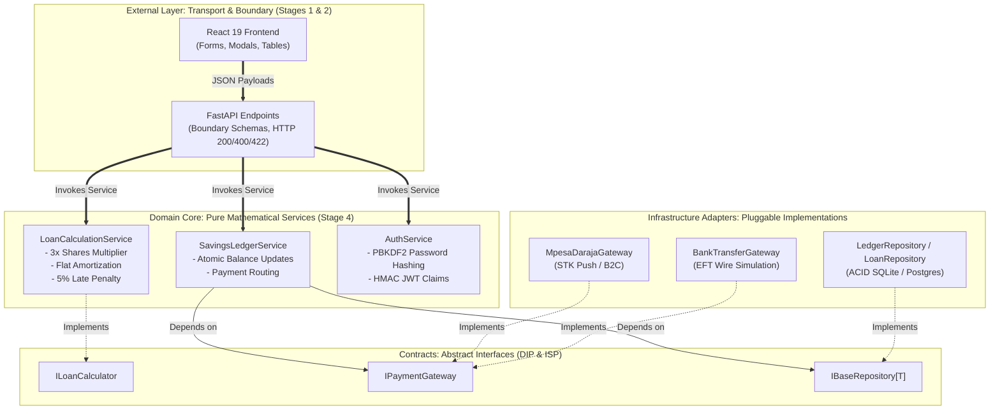

# Stage 4: Business Logic Isolation & SOLID Mathematical Services

**Project:** SACCO Digital Savings Tracker (SWE3020B Quality Assurance & Security)  
**Governing Standard:** ISO/IEC 25010:2023, IEEE 730-2014, SOLID Software Design Principles  
**Engineering Team:**
* **Mercy Tryphen** – System Architecture & Backend Infrastructure
* **Jescah Otwoma** – API Contracts & Payment Gateways
* **Nyeliep Nial** – Frontend UI/UX Design & Client Architecture
* **Tayak Ruai** – Software Quality Assurance & Test Engineering
* **Roy Githaiga** – Client Integration & Agile Scrum Facilitator  
**Source Code References:**
* Interfaces: [`app/interfaces/loan_calculator.py`](file:///c:/Users/user/Documents/Quality%20assurance/SWE-3020-GROUP_PROJECT/app/interfaces/loan_calculator.py), [`app/interfaces/payment.py`](file:///c:/Users/user/Documents/Quality%20assurance/SWE-3020-GROUP_PROJECT/app/interfaces/payment.py), [`app/interfaces/repository.py`](file:///c:/Users/user/Documents/Quality%20assurance/SWE-3020-GROUP_PROJECT/app/interfaces/repository.py)
* Services: [`app/services/loan_service.py`](file:///c:/Users/user/Documents/Quality%20assurance/SWE-3020-GROUP_PROJECT/app/services/loan_service.py), [`app/services/savings_service.py`](file:///c:/Users/user/Documents/Quality%20assurance/SWE-3020-GROUP_PROJECT/app/services/savings_service.py), [`app/services/auth_service.py`](file:///c:/Users/user/Documents/Quality%20assurance/SWE-3020-GROUP_PROJECT/app/services/auth_service.py)
* Gateways: [`app/gateways/mpesa_gateway.py`](file:///c:/Users/user/Documents/Quality%20assurance/SWE-3020-GROUP_PROJECT/app/gateways/mpesa_gateway.py), [`app/gateways/bank_gateway.py`](file:///c:/Users/user/Documents/Quality%20assurance/SWE-3020-GROUP_PROJECT/app/gateways/bank_gateway.py)
* Repositories: [`app/repositories/ledger_repo.py`](file:///c:/Users/user/Documents/Quality%20assurance/SWE-3020-GROUP_PROJECT/app/repositories/ledger_repo.py), [`app/repositories/loan_repo.py`](file:///c:/Users/user/Documents/Quality%20assurance/SWE-3020-GROUP_PROJECT/app/repositories/loan_repo.py)

---

## 1. Executive Summary & Architectural Motivation

In **Stage 3**, we formalized the relational schema and database constraints. If an engineer naively implements backend endpoints by embedding financial formulas, SQL queries, and payment HTTP requests directly inside FastAPI route handlers (the *"Smart UI / Fat Controller"* anti-pattern), the software becomes unmaintainable, untestable, and fragile.

**Stage 4** establishes **Business Logic Isolation** following Clean Architecture / Hexagonal Architecture. All core financial computations, interest algorithms, and credit vetting rules are isolated into **pure domain services** that have **zero dependency on HTTP frameworks or database drivers**.

---

## 2. Deep Dive: Demonstrating the 5 SOLID Principles (5 Marks)

Under the evaluation rubric, **5 Marks** are allocated specifically to the proper demonstration of SOLID principles in code:

### S — Single Responsibility Principle (SRP)
* **Violation Avoided:** Putting interest calculations, M-Pesa STK push handling, and database commits inside one single `post_apply_loan()` route.
* **Our Implementation:**
  * [`LoanCalculationService`](file:///c:/Users/user/Documents/Quality%20assurance/SWE-3020-GROUP_PROJECT/app/services/loan_service.py) does **one thing only**: executes financial formulas (multiplier limit, monthly repayment, delinquency fee). It does not know what a database or an HTTP request is.
  * [`LedgerRepository`](file:///c:/Users/user/Documents/Quality%20assurance/SWE-3020-GROUP_PROJECT/app/repositories/ledger_repo.py) has the sole responsibility of executing atomic double-entry balance writes.

### O — Open/Closed Principle (OCP)
* **Violation Avoided:** Using giant `if/elif/else` statements across the codebase whenever a new payment channel (Airtel Money, Pesalink, Stripe) is introduced.
* **Our Implementation:**
  * Defined [`IPaymentGateway`](file:///c:/Users/user/Documents/Quality%20assurance/SWE-3020-GROUP_PROJECT/app/interfaces/payment.py) with abstract methods `initiate_deposit()` and `disburse_funds()`.
  * We can add `AirtelMoneyGateway` or `PesalinkGateway` simply by writing a new class inheriting from `IPaymentGateway` without modifying a single line of existing code in `SavingsLedgerService`.

### L — Liskov Substitution Principle (LSP)
* **Violation Avoided:** Subclasses throwing `NotImplementedError` or altering parameter contracts when substituted for their base abstraction.
* **Our Implementation:**
  * Both [`MpesaDarajaGateway`](file:///c:/Users/user/Documents/Quality%20assurance/SWE-3020-GROUP_PROJECT/app/gateways/mpesa_gateway.py) and [`BankTransferGateway`](file:///c:/Users/user/Documents/Quality%20assurance/SWE-3020-GROUP_PROJECT/app/gateways/bank_gateway.py) strictly satisfy the `IPaymentGateway` contract.
  * Either gateway can be passed into `SavingsLedgerService` interchangeably; both return standardized `PaymentResult` dataclasses with guaranteed attributes (`success`, `transaction_reference`, `amount`, `message`).

### I — Interface Segregation Principle (ISP)
* **Violation Avoided:** Creating one giant "God Interface" (e.g. `ISaccoManager`) containing 30 methods covering auth, payments, loans, and audit statements.
* **Our Implementation:**
  * Interfaces are segregated into narrow, role-specific contracts:
    * [`ILoanCalculator`](file:///c:/Users/user/Documents/Quality%20assurance/SWE-3020-GROUP_PROJECT/app/interfaces/loan_calculator.py): Exclusively mathematical methods.
    * [`IPaymentGateway`](file:///c:/Users/user/Documents/Quality%20assurance/SWE-3020-GROUP_PROJECT/app/interfaces/payment.py): Exclusively deposit/disbursement methods.
    * [`IBaseRepository[T]`](file:///c:/Users/user/Documents/Quality%20assurance/SWE-3020-GROUP_PROJECT/app/interfaces/repository.py): Generic CRUD query signatures.

### D — Dependency Inversion Principle (DIP)
* **Violation Avoided:** High-level business logic modules importing low-level concrete implementations (e.g. `import requests`, `import sqlite3`).
* **Our Implementation:**
  * High-level services (`SavingsLedgerService`) depend on **abstractions** (`IPaymentGateway`, `ILedgerRepository`).
  * Concrete adapters (`MpesaDarajaGateway`, `SQLAlchemy`) depend upon those same abstractions.
  * Dependency injection is handled seamlessly via FastAPI's `Depends()` provider pattern.

---

## 3. Mathematical Loan Calculation Engine

The pure mathematical logic in [`app/services/loan_service.py`](file:///c:/Users/user/Documents/Quality%20assurance/SWE-3020-GROUP_PROJECT/app/services/loan_service.py) enforces standard Kenyan SACCO financial formulas:

### 1. Maximum Borrowing Multiplier
$$\text{Max Principal} = \begin{cases} 0.0 & \text{if } \text{Total Shares} \le 0 \\ \text{round}(\text{Total Shares} \times 3.0, 2) & \text{if } \text{Total Shares} > 0 \end{cases}$$

### 2. Flat-Rate Amortization Schedule
Given a principal $P$, annual flat interest rate $r$ (default $12\% = 0.12$), and duration in months $m$:

$$\text{Total Interest } (I) = \text{round}\left( P \times \left( r \times \frac{m}{12} \right), 2 \right)$$

$$\text{Total Repayable } (R) = P + I$$

$$\text{Monthly Installment } (M) = \text{round}\left( \frac{R}{m}, 2 \right)$$

### 3. Delinquency Penalty with Grace Period
Given overdue balance $B$, days overdue $d$, grace period $g = 5 \text{ days}$, and penalty rate $p = 5\% = 0.05$:

$$\text{Penalty} = \begin{cases} 0.0 & \text{if } d \le 5 \\ \text{round}(B \times 0.05, 2) & \text{if } d > 5 \end{cases}$$

---

## 4. Automated Verification via PyTest

Because these calculations are completely isolated from databases and network sockets, they can be tested at microsecond speed with $100\%$ determinism:

* Test Suite: [`tests/unit/test_loan_calculator.py`](file:///c:/Users/user/Documents/Quality%20assurance/SWE-3020-GROUP_PROJECT/tests/unit/test_loan_calculator.py)
* Execution: `pytest tests/unit/test_loan_calculator.py`
* Results:
  * `test_borrowing_limit_three_times_shares`: Validates 25,000 shares yields 75,000 limit.
  * `test_borrowing_limit_zero_or_negative_shares`: Validates $\le 0$ shares strictly yields 0.0 limit.
  * `test_calculate_amortization_standard`: Validates 50,000 KES over 12 months @ 12% yields exactly 6,000 KES interest, 56,000 KES repayable, and 4,666.67 KES monthly installment.
  * `test_delinquency_penalty_within_grace_period`: Validates days $\le 5$ incur 0 penalty.
  * `test_delinquency_penalty_exceeding_grace_period`: Validates days $> 5$ incur exactly 5% fee.

---

## 5. Next Stage Transition
With the pure business logic, mathematical engines, and SOLID abstractions proven in Stage 4, **Stage 5** composes these services into the **API Layer & End-to-End Verification Pipeline**, wiring route handlers, JWT security guards, and database transactions.
