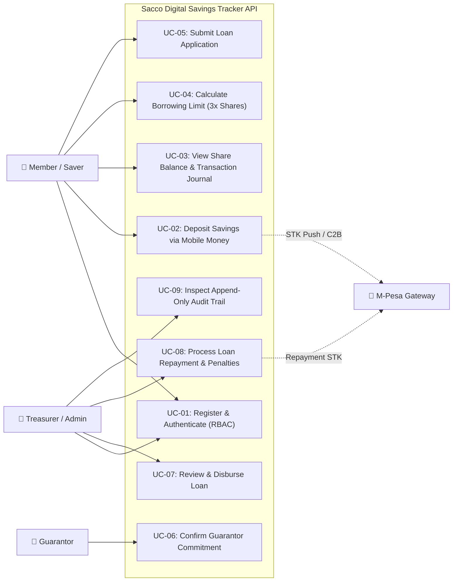

# Project Documentation: Sacco Digital Savings Tracker

**Course:** SWE3020B – Software Quality Assurance and Security  
**Institution:** United States International University - Africa (USIU-Africa)  
**Deliverable:** CAT 2 Project Evaluation (30 Marks)  
**Track:** Python Backend Engineering, Architecture & SQA  

---

## 1. Project Context & Problem Statement

### 1.1 Context
In community microfinance ecosystems across East Africa, informal savings groups (*chamas*) and community-based Savings and Credit Cooperative Organizations (SACCOs) serve as critical financial lifelines for millions of unbanked and underbanked citizens. These organizations pool member savings, issue affordable short-to-medium-term credit, and distribute collective dividends.

### 1.2 Problem Statement
Historically, these groups manage ledgers manually using paper record books and fragmented spreadsheets. This operational paradigm causes:
1. **Opacity and Fraud Risk:** Discrepancies between physical ledger books and cash in bank/vault accounts.
2. **Calculation Errors:** Manual, error-prone determination of borrowing thresholds (3x shares rule), amortization curves, and default penalties.
3. **Reconciliation Lag:** Days spent reconciling mobile money (M-Pesa) SMS receipts against individual member cards.
4. **Physical Record Degradation:** Vulnerability to theft, loss, damage, and lack of off-site disaster recovery.

### 1.3 Target Users & Stakeholders
* **Active Member / Saver:** Deposits monthly savings, tracks real-time share value, checks borrowing eligibility, and requests emergency/development loans.
* **Guarantor:** Vets peer members and legally commits a fraction of their personal shares to guarantee a loan applicant's debt.
* **Group Treasurer / Admin:** Reviews loan applications, approves disbursements, monitors loan repayments, and audits transaction trails.
* **Auditor / Regulatory Inspector:** Inspects append-only financial journals, verifies double-entry integrity, and exports forensic audit logs.

---

## 2. System Use Case Diagram

---

## 3. Functional Requirements Traceability Matrix

| Requirement ID | Specification Statement | Verification Method |
| :--- | :--- | :--- |
| **FR-01** | The system SHALL allow members and treasurers to authenticate securely using hashed credentials and receive JWT access tokens with role claims. | Unit + Integration API Tests |
| **FR-02** | The system SHALL ingest savings deposits through a mobile payment gateway abstraction (e.g. M-Pesa Daraja). | Mocked Strategy Tests |
| **FR-03** | The system SHALL atomically update the member's total savings and share capital upon successful transaction verification. | ACID Ledger Invariant Tests |
| **FR-04** | The system SHALL dynamically compute a member's borrowing limit as strictly $3 \times \text{Total Shares}$. | Deterministic Unit Tests |
| **FR-05** | The system SHALL permit loan applications only if requested principal $\le$ borrowing limit and applicant has no defaulted loans. | Rule Boundary Tests |
| **FR-06** | The system SHALL validate that guarantor commitments equal or exceed the unsecured portion of the requested loan. | Multi-Guarantor Logic Tests |
| **FR-07** | The system SHALL track loan amortized repayments and deduct principal and interest from the outstanding balance. | Balance Decay Tests |
| **FR-08** | The system SHALL automatically calculate and levy late penalties (5% per month) on overdue loan installments following a 5-day grace period. | Date-Boundary Unit Tests |
| **FR-09** | The system SHALL maintain an immutable, append-only ledger transaction journal for every balance delta. | Non-Mutation DB Tests |
| **FR-10** | The system SHALL log every administrative and financial action to a secure Audit Log containing actor email, action, entity ID, and timestamp. | Audit Inspection Tests |
